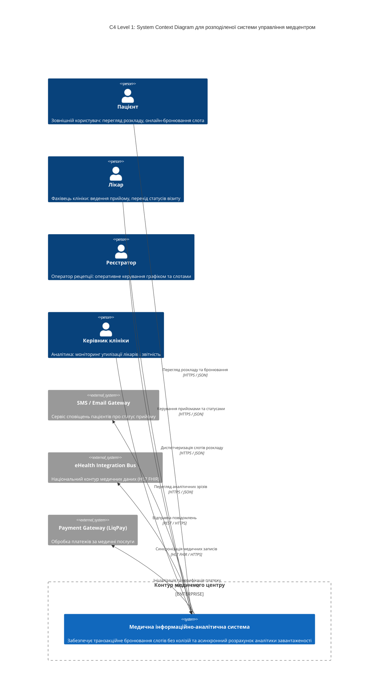
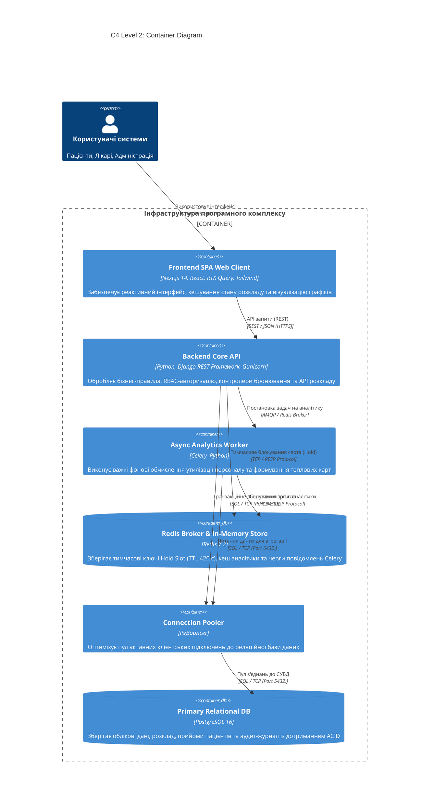
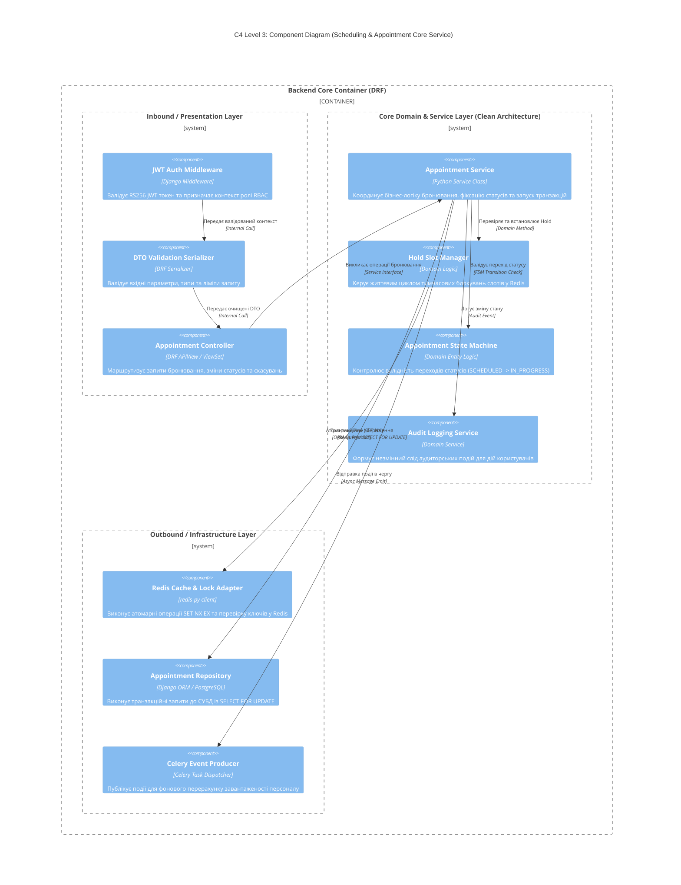
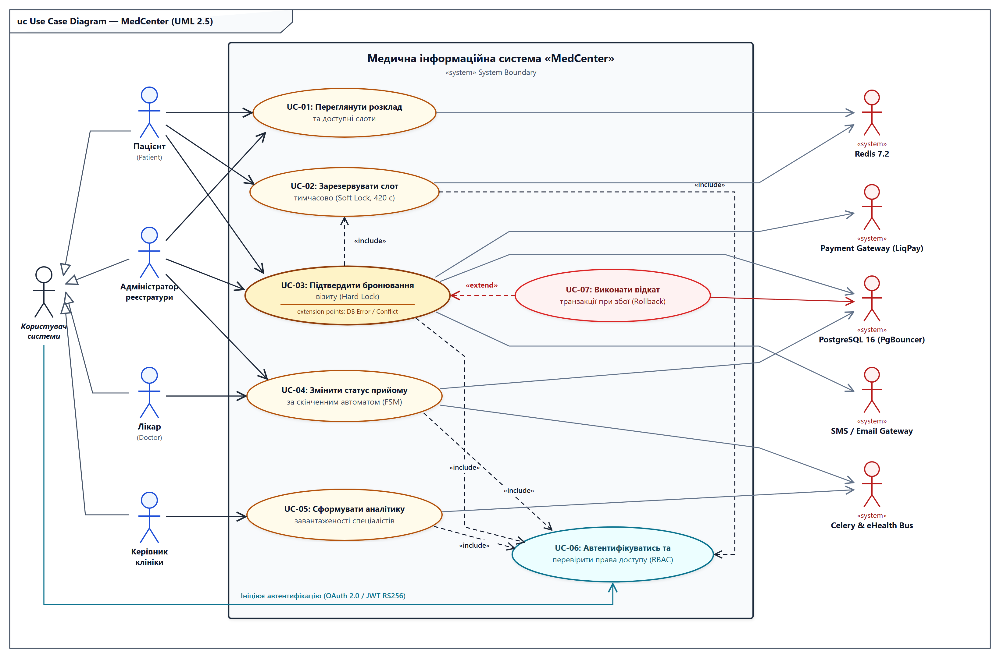
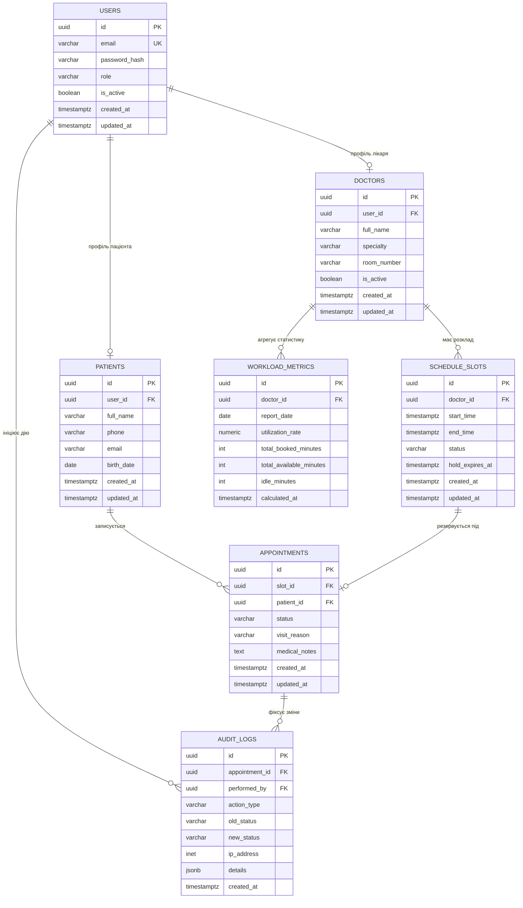
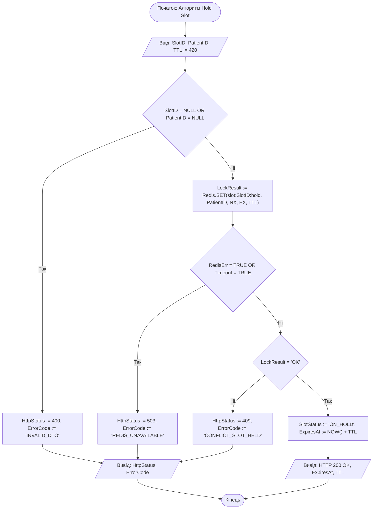
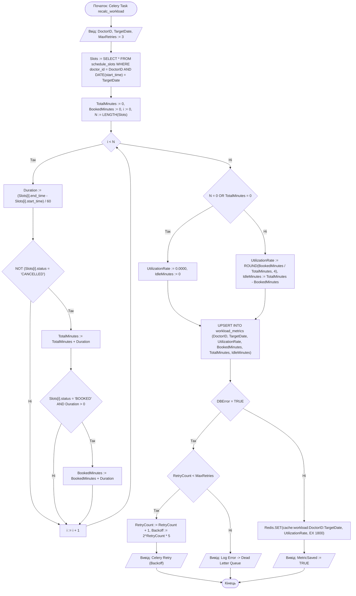

# РОЗДІЛ 2. ОБҐРУНТУВАННЯ АРХІТЕКТУРНИХ РІШЕНЬ ТА ПРОЄКТУВАННЯ СИСТЕМИ

Архітектурне ядро інформаційно-аналітичної системи управління медичним центром **MedCenter** спроєктовано за методологією **Docs-as-Code** із наскрізним трасуванням вимог специфікації [`srs.md`](./srs.md), журналу рішень [`adr/`](./adr/) та міжсервісного контракту [`api/openapi.yaml`](./api/openapi.yaml).

---

## 2.1. Обґрунтування архітектурної структури та патернів проєктування

### 2.1.1. Вибір макроархітектурного стилю

На основі функціональних вимог ([SRS-FUN-01..08](./srs.md#2-functional-requirements-функціональні-вимоги)) та цільової матриці продуктивності (Latency p95 <= 120 мс при 300 RPS на читання розкладу; Latency p95 <= 250 мс при 100 RPS на транзакційне бронювання; SLA >= 99.9%) для реалізації системи **MedCenter** обрано **розподілену багатошарову клієнт-серверну архітектуру з ізольованим асинхронним аналітичним контуром** (Decoupled Modular Backend + Async Worker Pipeline).

Вибір макростилю обґрунтовується такими інженерними компромісами:

1. **Відмова від класичного синхронного моноліту:** У монолітній архітектурі без черги фонових задач аналітичні SQL-агрегації за місячним розкладом блокують рядки операційних таблиць `SCHEDULE_SLOTS` і `APPOINTMENTS`, що підвищує затримку запису понад 5000 мс та призводить до вичерпання пулу з'єднань СУБД. Винесення агрегації у відокремлений контейнер **Celery Worker** повністю ізолює операційний HTTP-потік від важких обчислень ([SRS-NFR-PERF-03](./srs.md#3-non-functional-requirements-нефункціональні-вимоги)).
2. **Відмова від надмірної мікросервісної декомпозиції:** На етапі первинного розгортання клініки розбиття ядра домену (користувачі, лікарі, слоти, прийоми) на окремі мережеві мікросервіси вимагало б впровадження патерну Saga для розподілених транзакцій, створювало б додаткові мережеві затримки на міжсервісній серіалізації та суттєво підвищувало б вартість інфраструктури (FinOps). Натомість **модульне ядро на Django REST Framework** забезпечує сувору ізоляцію піддоменів у межах однієї ACID-транзакції PostgreSQL.
3. **Горизонтальне масштабування без стану (Stateless Backend):** Контейнери **Backend Core API** не зберігають стан сесії в оперативній пам'яті процесів Gunicorn — авторизація спирається на асиметричні JWT (`RS256`), а спільні блокування та кеш винесені в **Redis 7.2**. Це дозволяє масштабувати API до 10 реплік за зворотним проксі Nginx ([SRS-NFR-SCAL-01](./srs.md#3-non-functional-requirements-нефункціональні-вимоги)), а пул з'єднань **PgBouncer** у режимі `transaction pooling` утримує до 1000 клієнтських з'єднань без вичерпання пам'яті PostgreSQL 16 ([SRS-NFR-SCAL-02](./srs.md#3-non-functional-requirements-нефункціональні-вимоги)).

### 2.1.2. Патерни проєктування мікрорівня (Code-Level Patterns)

Для запобігання жорсткій зв'язаності коду (Tight Coupling) та забезпечення тестованості доменної логіки всередині серверного контейнера застосовано комплекс інженерних патернів:

* **Clean Architecture (Inbound / Core Domain / Outbound Separation):** Розділяє маршрутизацію HTTP, чисті доменні сервіси та інфраструктурні адаптери БД/Redis. Контролери не виконують прямих ORM-запитів, що унеможливлює витік бізнес-інваріантів у шар представлення.
* **Repository & Unit of Work (Транзакційний доступ до БД):** Усі операції зміни стану слотів та створення записів інкапсульовані в `AppointmentRepository` у межах атомарного блоку `transaction.atomic()` (`READ COMMITTED` із `SELECT ... FOR UPDATE`), що гарантує цілісність даних при конкурентному навантаженні.
* **Hybrid Distributed Locking (Redis Soft Lock + PostgreSQL Hard Lock):** Розв'язує проблему **Double-Booking** без утримання довгих транзакцій у СУБД (деталізовано в [ADR-001](./adr/0001-choice-of-technology.md)). Для усунення ризику Single Point of Failure на рівні Redis передбачено конфігурацію реплікації **Redis Sentinel** та детермінований fallback-статус `503 Service Unavailable` з таймаутом клієнта 500 мс.
* **Finite State Machine (FSM):** Клас `AppointmentStateMachine` формалізує граф допустимих переходів життєвого циклу візиту (`SCHEDULED -> IN_PROGRESS -> COMPLETED / CANCELLED`), блокуючи несанкціоновані зміни статусу та записуючи аудит-слід.
* **DTO / Serializer Boundary Validation:** Типізовані серіалізатори DRF із білим списком полів перетворюють неструктурований JSON-потік у валідовані об'єкти передачі даних, захищаючи моделі БД від атак Mass Assignment.
* **Exponential Backoff Retry & Queue Isolation:** Фонові задачі Celery (`recalc_workload`, розсилка SMS) налаштовані з обмеженням `max_retries = 3` та експоненційною затримкою `2^k * 5` с. Збій зовнішнього шлюзу чи переповнення черги перенаправляє задачу у Dead Letter Queue (DLQ) без впливу на API бронювання.

---

## 2.2. Контекстне та контейнерне моделювання системи (C4 Model: Levels 1–2)

### 2.2.1. C4 Рівень 1: Діаграма системного контексту (System Context Diagram)

Діаграма визначає межі програмної системи **MedCenter**, ключові ролі користувачів та зовнішні інтеграційні шлюзи.

**Текстовий опис та трасування Context рівня:**

* Система підтримує 4 ролі акторів, взаємодіючи через протокол `HTTPS / JSON` (TLS 1.3) із застосуванням JWT-авторизації згідно з [SRS-FUN-01](./srs.md#2-functional-requirements-функціональні-вимоги).
* Зовнішня інтеграція зі шлюзами сповіщень та платіжним провайдером реалізується з урахуванням асинхронних повторних спроб ([SRS-FUN-08](./srs.md#2-functional-requirements-функціональні-вимоги)).

### 2.2.2. C4 Рівень 2: Контейнерна діаграма (Container Diagram)

Діаграма демонструє фізичний поділ системи на окремо розгорнуті контейнери, балансувальник пулу з'єднань, сховища та чергу фонових задач.

**Текстовий опис та трасування зв'язків контейнерів:**

* Контейнер **Frontend SPA Web Client** реалізує нормалізований кеш та інвалідацію тегів RTK Query ([SRS-FUN-07](./srs.md#2-functional-requirements-функціональні-вимоги)).
* Контейнер **Redis Broker & In-Memory Store** забезпечує патерн Hold Slot (TTL = 420 с) відповідно до [ADR-001](./adr/0001-choice-of-technology.md) та [SRS-FUN-02](./srs.md#2-functional-requirements-функціональні-вимоги).
* Контейнер **Backend Core API** виконує транзакційне бронювання у **PostgreSQL** через пулер **PgBouncer** ([SRS-FUN-04](./srs.md#2-functional-requirements-функціональні-вимоги), [SRS-NFR-SCAL-02](./srs.md#3-non-functional-requirements-нефункціональні-вимоги)).
* Контейнер **Async Analytics Worker (Celery)** виконує фоновий розрахунок метрик завантаженості та кешує результати в Redis на 1800 с ([SRS-FUN-06](./srs.md#2-functional-requirements-функціональні-вимоги), [SRS-NFR-PERF-03](./srs.md#3-non-functional-requirements-нефункціональні-вимоги)).

---

## 2.3. Компонентне моделювання, опис серверного ядра та ADR-001 (C4 Level 3)

Для деталізації обрано критичний контейнер бекенду — **Scheduling & Appointment Service**, що відповідає за конкурентне бронювання слотів і зміну статусів прийому.

### 2.3.1. Технічний опис взаємодії рівнів серверного ядра

Обробка кожного HTTP-запиту проходить ізольований трирівневий конвеєр (`Inbound Layer -> Core Layer -> Outbound Layer`), що гарантує однонаправлену залежність і виключає прямий доступ контролерів до інфраструктури:

1. **Inbound / Presentation Layer (Вхідний периметр):**
   * `JWT Auth Middleware` перехоплює заголовок `Authorization: Bearer <token>`, перевіряє цифровий підпис за публічним ключем `RS256`, декодує `user_id` і `role`, а також блокує протерміновані токени статусом `401 Unauthorized`.
   * `DTO Validation Serializer` (DRF Serializers із забороною додаткових полів) перевіряє типи UUID, дати ISO-8601, довжину рядків та допустимі значення переліків (`enum`), повертаючи `400 Bad Request` до виклику бізнес-логіки.
   * `Appointment Controller` формує DTO-команду та перевіряє об'єктний доступ (`IDOR/BOLA` Guard) перед передачею керування в `Appointment Service`.
2. **Core Domain & Service Layer (Ядро доменної логіки):**
   * `Appointment Service` виступає оркестратором сценарію: координує перевірку тимчасового утримання, запуск транзакції БД та формування доменної події.
   * `Hold Slot Manager` інкапсулює інваріанти тимчасового резервування (`TTL = 420` с) і перевірку відповідності власника блокування `HoldPatientID == CurrentPatientID`.
   * `Appointment State Machine` валідує матрицю допустимих переходів візиту (`SCHEDULED -> IN_PROGRESS`, `IN_PROGRESS -> COMPLETED`, `SCHEDULED -> CANCELLED`), відхиляючи некоректні переходи (`409 Conflict`).
   * `Audit Logging Service` формує незмінний запис про подію (`performed_by`, `old_status`, `new_status`, `ip_address`) у межах тієї самої транзакції.
3. **Outbound / Infrastructure Layer (Шар адаптерів інфраструктури):**
   * `Redis Cache & Lock Adapter` (`redis-py` з пулом з'єднань та таймаутом 500 мс) виконує атомарні операції `SET NX EX`, `GET`, `TTL` та `DEL`.
   * `Appointment Repository` транслює доменні команди в параметризовані ORM/SQL-запити до PostgreSQL 16 із застосуванням `SELECT ... FOR UPDATE` та гарантованим `ROLLBACK` при збої.
   * `Celery Event Producer` публікує повідомлення `recalc_workload.delay(doctor_id, report_date)` у брокер після успішного `COMMIT` (`transaction.on_commit`), що запобігає «примарним» задачам при відкаті транзакції.

### 2.3.2. Реєстр архітектурних рішень (ADR)

| Індекс | Прийняте рішення | Статус | Трасування |
| :--- | :--- | :--- | :--- |
| [ADR-001](./adr/0001-choice-of-technology.md) | Гібридне блокування конкурентного доступу: Redis Soft Lock (TTL = 420 с) + PostgreSQL `SELECT FOR UPDATE` | Approved | [SRS-FUN-02](./srs.md#2-functional-requirements-функціональні-вимоги), [SRS-FUN-04](./srs.md#2-functional-requirements-функціональні-вимоги) |

---

## 2.4. Контур безпеки програмного рішення (Application Security — AppSec)

Контур безпеки **MedCenter** спроєктовано відповідно до вимог **OWASP Top 10:2021**, **OWASP API Security Top 10:2023** та нормативів обробки чутливих медичних даних (Закон України «Про захист персональних даних», GDPR):

1. **Криптографічний захист паролів (`Argon2id`):** Збереження облікових даних у таблиці `USERS` реалізовано з використанням алгоритму **Argon2id** (параметри: виділення пам'яті `m = 64 MiB`, кількість ітерацій `t = 3`, ступінь паралелізму `p = 4`) та індивідуальною 128-бітною криптографічною сіллю для кожного запису, що забезпечує стійкість до GPU/ASIC перебору.
2. **Захист від Mass Assignment (BOPLA / Broken Object Property Level Authorization):** Усі контролери ізольовані від безпосереднього оновлення моделей ORM через `request.data`. Вхідні тіла запитів десеріалізуються через суворі DRF Serializers із фіксованим переліком полів (`fields = (...)`, `read_only_fields = ('id', 'created_at', 'status')`), що унеможливлює підміну системних атрибутів (`role`, `is_active`, `status`).
3. **Захист від BOLA / IDOR (Broken Object Level Authorization):** На рівні сервісу та permission-класів (`IsAppointmentParticipantOrStaff`) обов'язково перевіряється інваріант володіння ресурсом:
   `appointment.patient.user_id == request.user.id OR request.user.role IN ('Doctor', 'Registrar')`.
4. **Безпека авторизаційних сесій (JWT RS256 + Secure Cookies):** Короткоживучі Access-токени (TTL = 15 хвилин) підписуються асиметричним алгоритмом **RS256** (приватний ключ — виключно на сервері автентифікації). Refresh-токени (TTL = 7 днів) передаються виключно у захищених cookie з прапорцями `HttpOnly`, `Secure`, `SameSite=Strict`, що унеможливлює їх перехоплення через XSS.
5. **Захист від Brute-Force та DoS (Rate Limiting & Request Limits):** На рівні шлюзу Nginx і Django Throttling застосовано обмеження: `100 req/min` на IP для операційних ендпоінтів, `10 req/min` на IP для маршруту `/api/v1/auth/token`, та ліміт розміру JSON-тіла `client_max_body_size 2m`.
6. **Захист від ін'єкцій та шифрування даних:** Усі запити до PostgreSQL 16 виконуються виключно через параметризовані вирази Django ORM / prepared statements (захист від SQLi). Транспортний трафік захищено протоколом **TLS 1.3**, а чутливі клінічні нотатки (`APPOINTMENTS.medical_notes`) шифруються симетричним алгоритмом **AES-256-GCM** на рівні прикладного адаптера до запису в БД.
7. **Незмінний журнал аудиту (Append-Only Audit Logging):** Усі критичні операції (`APPOINTMENT_CREATED`, `STATUS_CHANGED`, `DB_TIMEOUT_ROLLBACK`, `AUTH_FAILED`) фіксуються у таблиці `AUDIT_LOGS` із збереженням `performed_by`, `ip_address` (`INET`) та `created_at`. На рівні ролі СУБД для додатка діє заборона `REVOKE UPDATE, DELETE ON audit_logs`.
8. **Гігієна середовища та DevSecOps:** Секретні ключі (`JWT_PRIVATE_KEY`, `DATABASE_URL`, `AES_MASTER_KEY`) винесені зі сховища коду у змінні середовища та секрети CI/CD; у конвеєрі GitHub Actions передбачено перевірку залежностей і образів інструментами `Bandit`, `pip-audit` і `Trivy`.

---

## 2.5. Специфікація міжсервісних контрактів (API) та топологія маршрутів

Міжсервісна взаємодія між контейнерами **Frontend SPA (Next.js)** та **Backend Core API (Django DRF)** формалізована за принципом **API-First Design** у файлі [`openapi.yaml`](./api/openapi.yaml) (OpenAPI 3.0.3).

### 2.5.1. Топологічна матриця API-маршрутів (Карта інтерфейсів системи)

| ID маршруту | Метод | Топологічний шлях (URI) | Вхідні параметри / Payload | Призначення та Контейнер-обробник |
| :--- | :--- | :--- | :--- | :--- |
| **API-REQ-01** | `POST` | `/api/v1/auth/token` | Body: `{email: string, password: string}` | Автентифікація (Argon2id), видача RS256 Access JWT та httpOnly Refresh cookie (`Backend Core API`) |
| **API-REQ-02** | `GET` | `/api/v1/schedule/slots` | Query: `doctor_id? (uuid), start_date (date), end_date (date), page (int >= 1), limit (int 1..100)` | Пагінована вибірка розкладу з B-Tree індексом та кешем (`Backend Core API` $\rightarrow$ `PgBouncer` / `PostgreSQL 16`) |
| **API-REQ-03** | `POST` | `/api/v1/schedule/slots/{id}/hold` | Path: `id (uuid)`, Body: `{patient_id: uuid}` | Встановлення атомарного Soft Lock у Redis на `TTL = 420` с (`Backend Core API` $\rightarrow$ `Redis 7.2`) |
| **API-REQ-04** | `POST` | `/api/v1/appointments` | Body: `{slot_id: uuid, patient_id: uuid, visit_reason: string (5..500)}` | Транзакційне створення запису з `SELECT ... FOR UPDATE` (`Backend Core API` $\rightarrow$ `PostgreSQL 16` + `Redis 7.2`) |
| **API-REQ-05** | `PATCH` | `/api/v1/appointments/{id}/status` | Path: `id (uuid)`, Body: `{new_status: enum, medical_notes?: string}` | Переведення статусу візиту за FSM та запуск перерахунку (`Backend Core API` $\rightarrow$ `PostgreSQL 16` + `Celery`) |
| **API-REQ-06** | `GET` | `/api/v1/analytics/workload` | Query: `doctor_id? (uuid), start_date (date), end_date (date), page (int >= 1), limit (int 1..100)` | Видача агрегованих метрик утилізації з кешу Redis або БД (`Backend Core API` $\leftarrow$ `Redis 7.2` / `Celery Worker`) |

### 2.5.2. Наскрізні потоки даних (Data Flows)

#### Потік даних DF-01: Конкурентне резервування слота та транзакційне бронювання прийому

1. **Крок 1 (Ініціація резервування):** Клієнт Next.js (`RTK Query`) надсилає `HTTPS POST /api/v1/schedule/slots/{id}/hold` (TLS 1.3) із заголовком `Authorization: Bearer <JWT>` та JSON-тілом `{patient_id}` (перевірка `Content-Length <= 2 MB`).
2. **Крок 2 (Шлюзова фільтрація та автентифікація):** Nginx перевіряє CORS-заголовок походження (`https://medcenter.local`) та IP-ліміт (`100 req/min`). У контейнері **Backend Core API** компонент `JWT Auth Middleware` валідує підпис `RS256` та права ролі (`Patient` або `Registrar`), а `DTO Validation Serializer` перевіряє формат UUID.
3. **Крок 3 (Атомарний Soft Lock):** `Hold Slot Manager` через `Redis Lock Adapter` виконує `SET slot:{id}:hold {patient_id} NX EX 420`. У разі колізії повертається `409 Conflict`; при успіху API відповідає `200 OK` з `hold_expires_at` і `ttl_seconds = 420`.
4. **Крок 4 (Підтвердження бронювання):** Пацієнт вводить `visit_reason`, після чого фронтенд надсилає `HTTPS POST /api/v1/appointments`. Сервер звіряє власника ключа в Redis (`HoldPatientID == CurrentPatientID`).
5. **Крок 5 (Транзакційна фіксація Hard Lock):** `Appointment Repository` через `PgBouncer` (порт `6432`) відкриває транзакцію `READ COMMITTED` у PostgreSQL 16 (`SELECT ... FOR UPDATE`), створює запис у `APPOINTMENTS`, переводить статус слота в `BOOKED`, записує подію в `AUDIT_LOGS` і виконує `COMMIT`.
6. **Крок 6 (Очищення та фоновий тригер):** Після `COMMIT` адаптер видаляє ключ у Redis (`DEL slot:{id}:hold`), `Celery Event Producer` ставить задачу `recalc_workload` у чергу Redis, а клієнт отримує `201 Created` з об'єктом `Appointment` (RTK Query автоматично інвалідує теги кешу `ScheduleSlot` і `Appointment`).

#### Потік даних DF-02: Перехід статусу прийому (FSM) та асинхронна агрегація аналітики

1. **Крок 1 (Оновлення статусу):** Лікар ініціює `HTTPS PATCH /api/v1/appointments/{id}/status` з `new_status = 'COMPLETED'`.
2. **Крок 2 (Валідація та збереження):** Бекенд перевіряє права доступу (`IDOR/BOLA` — лише закріплений лікар або реєстратор), `Appointment State Machine` підтверджує допустимість переходу, дані шифруються (`AES-256` для `medical_notes`) та фіксуються в PostgreSQL 16 разом із записом в `AUDIT_LOGS`.
3. **Крок 3 (Фонова агрегація):** Воркер **Celery** зчитує слоти зміни з PostgreSQL, обчислює `utilization_rate`, виконує `UPSERT` у таблицю `WORKLOAD_METRICS` та оновлює кеш у Redis (`SET cache:workload:{doctor_id}:{date} ... EX 1800`).
4. **Крок 4 (Видача аналітики):** Керівник клініки запитує `GET /api/v1/analytics/workload?start_date=...&end_date=...&page=1&limit=20`. Бекенд перевіряє роль `ClinicManager`, зчитує агреговані зрізи з Redis за `<= 50 мс` (або з `WORKLOAD_METRICS` при cache miss) та повертає пагіновану JSON-відповідь `200 OK`.

### 2.5.3. Мережеві обмеження та інваріанти безпеки транспортного рівня

* **Max Body Size:** Розмір JSON-запиту обмежено `2 МБ` на рівні Nginx (`client_max_body_size 2m`) для запобігання виснаженню пам'яті.
* **Пагінація:** Спискові маршрути (`GET /schedule/slots`, `GET /analytics/workload`) використовують обов'язкову пагінацію з параметрами `page` (за замовчуванням `1`) та `limit` (за замовчуванням `20`, верхня межа `100`).
* **CORS-політика:** Заголовки `Access-Control-Allow-Origin` обмежено виключно довіреним доменом клієнта `https://medcenter.local` із підтримкою `Access-Control-Allow-Credentials: true` для захищених `httpOnly` cookie.
* **Захист чутливих параметрів у URL:** Конфіденційні дані (паролі, JWT, клінічні нотатки) ніколи не передаються у Query-параметрах URI; використовуються виключно `POST`/`PATCH` тіла запиту поверх TLS 1.3 та HTTP-заголовок `Authorization`.

---

## 2.6. Моделювання користувацького досвіду та транзакційних сценаріїв (Use Cases)

### 2.6.1. Діаграма прецедентів системи (UML Use Case Diagram)

Діаграму прецедентів розроблено у стандарті UML 2.5 із дотриманням вимог CASE-моделювання (первинні актори ліворуч з узагальненням до абстрактного актора `Користувач системи`, вторинні зовнішні системи праворуч, межі системи `MedCenter`, зв'язки асоціації, `«include»` та `«extend»`). Джерело проєкту збережено у форматі StarUML [`medcenter_use_case.mdj`](./diagrams/medcenter_use_case.mdj).

### 2.6.2. Специфікація прецеденту UC-03: Двоетапне транзакційне бронювання візиту

* **ID та Назва прецеденту:** `UC-03: Двоетапне транзакційне бронювання візиту (Hold Slot + Hard Lock)`
* **Первинний актор:** Пацієнт (або Адміністратор реєстратури)
* **Вторинні актори:** `Redis 7.2`, `PostgreSQL 16 (PgBouncer)`, `Payment Gateway (LiqPay)`, `SMS / Email Gateway`, `Celery Worker`
* **Короткий опис:** Забезпечує вибір та гарантоване транзакційне бронювання вільного тайм-слота лікаря без ризику виникнення колізій Double-Booking.

#### Preconditions (Інженерні передумови)

* **Продуктові:** Користувач автентифікований у системі (роль `Patient` або `Registrar`), сесія активна, передано валідний `Bearer JWT`, у клієнтському інтерфейсі відкрито сітку доступних слотів лікаря.
* **Інфраструктурні:** З'єднання з Redis активне (`PING -> PONG < 2 мс`), пул з'єднань PgBouncer до PostgreSQL 16 доступний, цільовий запис у таблиці `SCHEDULE_SLOTS` існує та перебуває у статусі `FREE`.

#### Main Success Scenario / Happy Path (Еталонний сценарій)

| Крок | Дія Актора | Реакція та відповідь сервера / БД |
| :--- | :--- | :--- |
| 1. | Пацієнт обирає вільний слот у розкладі та ініціює резервування. | Frontend (`RTK Query`) надсилає `POST /api/v1/schedule/slots/{id}/hold` із тілом `{patient_id}` та `Bearer JWT`. `JWT Auth Middleware` перевіряє підпис RS256 та роль; `DTO Validation Serializer` валідує UUID. |
| 2. | Сервер накладає тимчасовий Soft Lock у пам'яті. | `Hold Slot Manager` викликає `SET slot:{id}:hold {patient_id} NX EX 420` у Redis. Redis повертає `OK`. Сервер повертає `HTTP 200 OK` з полями `hold_expires_at` і `ttl_seconds = 420`. |
| 3. | Клієнтський інтерфейс фіксує 7-хвилинний таймер резерву та відкриває форму запису. | Через RTK Query стан слота локально відображається як `ON_HOLD`. Пацієнт вводить причину звернення (`visit_reason`) та підтверджує запис. |
| 4. | Пацієнт натискає «Підтвердити бронювання». | Frontend надсилає `POST /api/v1/appointments` із тілом `{slot_id, patient_id, visit_reason}`. Сервер валідує DTO (`minLength: 5`, `maxLength: 500`) та права доступу (`IDOR` Guard). |
| 5. | Сервер перевіряє власника Soft Lock у Redis. | Виконується `GET slot:{id}:hold` та `TTL slot:{id}:hold`. Перевіряється `HoldPatientID == CurrentPatientID AND TTL > 0`. |
| 6. | Сервер відкриває транзакцію PostgreSQL та блокує рядок. | `Appointment Repository` через PgBouncer запускає `BEGIN TRANSACTION ISOLATION LEVEL READ COMMITTED` і виконує `SELECT * FROM schedule_slots WHERE id = slot_id FOR UPDATE`. |
| 7. | Сервер фіксує прийом, оновлює слот та записує аудит. | Виконується `INSERT INTO appointments (slot_id, patient_id, status='SCHEDULED', visit_reason)`, `UPDATE schedule_slots SET status = 'BOOKED', hold_expires_at = NULL`, `INSERT INTO audit_logs (action_type='APPOINTMENT_CREATED', ip_address=...)` і `COMMIT TRANSACTION`. |
| 8. | Сервер знімає Redis-лок, запускає фонові задачі та відповідає клієнту. | Виконується `DEL slot:{id}:hold`. Після `COMMIT` ініціюються Celery-задачі `recalc_workload` та `send_booking_sms`. Сервер повертає `HTTP 201 Created` із DTO створеного прийому. |

#### Postconditions (Постумови)

У таблиці `APPOINTMENTS` створено незворотний запис зі статусом `SCHEDULED`; рядок у `SCHEDULE_SLOTS` переведено у статус `BOOKED`; у `AUDIT_LOGS` зафіксовано незмінний запис аудиту з `ip_address`; тимчасовий ключ у Redis вилучено; фонова задача перерахунку аналітики та SMS-сповіщення поставлена в чергу Celery.

#### Alternative Flows (Альтернативні потоки)

* **ID потоку:** `AF-03A` — Конкурентне захоплення слота іншим користувачем
  * **Старт із кроку Happy Path:** Крок №2
  * **Умова-тригер:** Інший клієнт встиг виконати `SET ... NX` на той самий `slot_id` мілісекундою раніше.
  * **Повернення на крок Happy Path:** Крок №1 (вибір іншого слота).

| Крок | Дія Актора | Реакція та відповідь системи |
| :--- | :--- | :--- |
| 1. | Пацієнт очікує підтвердження резервування слота. | Команда Redis `SET slot:{id}:hold ... NX` повертає `nil`. `Hold Slot Manager` фіксує конфлікт та повертає `HTTP 409 Conflict` (`CONFLICT_SLOT_HELD`). |
| 2. | Пацієнт бачить повідомлення про зайнятість слота та обирає інший вільний час. | Frontend інвалідує кеш `GET /api/v1/schedule/slots`, оновлює сітку розкладу і повертає користувача до вибору слота на Крок №1. |

* **ID потоку:** `AF-03B` — Вичерпання часу утримання слота (TTL = 420 с закінчився до підтвердження)
  * **Старт із кроку Happy Path:** Крок №5
  * **Умова-тригер:** Пацієнт заповнював форму довше 7 хвилин; `GET slot:{id}:hold` повертає `nil` або `HoldPatientID != CurrentPatientID`.
  * **Повернення на крок Happy Path:** Крок №1 (повторне резервування).

| Крок | Дія Актора | Реакція та відповідь системи |
| :--- | :--- | :--- |
| 1. | Пацієнт надсилає форму підтвердження після завершення таймера. | Бекенд не запускає транзакцію БД, відхиляє запит статусом `HTTP 409 Conflict` (`HOLD_EXPIRED`) без змін у `SCHEDULE_SLOTS`. |
| 2. | Пацієнт ініціює повторне бронювання або обирає новий слот. | Frontend відображає попередження про вичерпання таймера утримання, оновлює розклад через RTK Query та повертає сценарій на Крок №1. |

#### Exception Flows (Руйнівні технічні збої)

* **Exception Flow ID:** `EF-03A`
* **Назва збою:** Таймаут блокування або обрив з'єднання з PostgreSQL під час транзакції фіксації (Кроки №6–7)
* **Умова-тригер:** Під час виконання `SELECT ... FOR UPDATE` або `INSERT INTO appointments` виникає `OperationalError` / `LockTimeout` / обрив каналу PgBouncer.

| Крок | Дії для UI / Користувача | Технічні дії сервера та БД |
| :--- | :--- | :--- |
| 1. | Користувач бачить індикатор повторної спроби та повідомлення: «Тимчасова помилка збереження запису. Ваш слот утримується, повторіть підтвердження». | Перехоплювач транзакції миттєво виконує `ROLLBACK TRANSACTION` (запис у `APPOINTMENTS` не створюється, статус у `SCHEDULE_SLOTS` залишається `FREE`). Сервер логує подію `DB_TIMEOUT_ROLLBACK` (в асинхронний stdout/файл та аудит) і продовжує час утримання ключа в Redis (`EXPIRE slot:{id}:hold 300`), якщо ключ належить поточному пацієнту. |
| 2. | Користувач натискає «Повторити підтвердження» або обирає інший час. | Сервер повертає `HTTP 500 Internal Error` (`DB_TRANSACTION_FAILED`), зберігаючи 100% консистентність БД без дублікатів і «завислих» прийомів. |

* **Exception Flow ID:** `EF-03B`
* **Назва збою:** Повна недоступність або таймаут кластера Redis під час резервування (Крок №2)
* **Умова-тригер:** Таймаут підключення до Redis перевищує 500 мс (`redis.exceptions.ConnectionError` / `TimeoutError`).

| Крок | Дії для UI / Користувача | Технічні дії сервера та БД |
| :--- | :--- | :--- |
| 1. | Користувач отримує коректне повідомлення: «Сервіс тимчасового бронювання перевантажений. Спробуйте через хвилину». | `Redis Lock Adapter` перериває очікування за таймаутом 500 мс (запобігання каскадному блокуванню воркерів Gunicorn), записує інцидент у моніторинг Prometheus і повертає `HTTP 503 Service Unavailable` (`REDIS_UNAVAILABLE`) без модифікації PostgreSQL. |

---

### 2.6.3. Специфікація прецеденту UC-04: Управління життєвим циклом візиту (FSM) та оновлення аналітики

* **ID та Назва прецеденту:** `UC-04: Управління життєвим циклом прийому за скінченним автоматом (FSM) та перерахунок аналітики`
* **Первинний актор:** Лікар (або Адміністратор реєстратури при скасуванні)
* **Вторинні актори:** `PostgreSQL 16 (PgBouncer)`, `Redis 7.2`, `Celery Worker`, `eHealth Bus (HL7 FHIR)`
* **Короткий опис:** Забезпечує регламентовану зміну статусу медичного прийому (`SCHEDULED -> IN_PROGRESS -> COMPLETED / CANCELLED`), шифроване збереження клінічних нотаток та запуск асинхронного перерахунку завантаженості.

#### Preconditions (Інженерні передумови)

* **Продуктові:** Користувач авторизований із роллю `Doctor` або `Registrar`, відкрито картку активного візиту; лікар закріплений за відповідним слотом (`slot.doctor.user_id == request.user.id`).
* **Інфраструктурні:** Пул PgBouncer доступний, запис в `APPOINTMENTS` існує та перебуває в нетермінальному статусі (`SCHEDULED` або `IN_PROGRESS`), модуль шифрування `AES-256` ініціалізовано.

#### Main Success Scenario / Happy Path (Еталонний сценарій)

| Крок | Дія Актора | Реакція та відповідь сервера / БД |
| :--- | :--- | :--- |
| 1. | Лікар завершує прийом, вносить клінічні нотатки та натискає «Завершити візит». | Frontend надсилає `PATCH /api/v1/appointments/{id}/status` із `{new_status: "COMPLETED", medical_notes}` та `Bearer JWT`. |
| 2. | Сервер перевіряє авторизацію, DTO та володіння ресурсом. | `JWT Auth Middleware` підтверджує роль `Doctor`; перевіряється `IDOR` інваріант (`slot.doctor.user_id == request.user.id`); DRF Serializer валідує `maxLength: 2000`. |
| 3. | Сервер валідує перехід у скінченному автоматі (FSM). | `Appointment State Machine` перевіряє, чи є перехід `current_status -> new_status` дозволеним згідно з матрицею станів. |
| 4. | Сервер шифрує нотатки та виконує транзакційне оновлення БД. | Поле `medical_notes` шифрується за алгоритмом `AES-256-GCM`. У транзакції PostgreSQL виконується `UPDATE appointments SET status = 'COMPLETED', medical_notes = ...` і `INSERT INTO audit_logs (action_type='STATUS_CHANGED', old_status, new_status, ip_address)`. |
| 5. | Сервер фіксує транзакцію та публікує асинхронну задачу. | Після `COMMIT` через `transaction.on_commit()` викликається `recalc_workload.delay(doctor_id, report_date)` у чергу Celery. |
| 6. | Лікар бачить оновлений статус прийому. | Сервер повертає `HTTP 200 OK` з оновленим DTO `Appointment`; воркер Celery фоново оновлює `WORKLOAD_METRICS` та кеш Redis (`TTL 1800` с). |

#### Postconditions (Постумови)

Статус прийому в `APPOINTMENTS` незворотно оновлено, зашифровані клінічні нотатки збережені в PostgreSQL, в `AUDIT_LOGS` додано запис зміни стану, а задача перерахунку показників утилізації персоналу оброблена або поставлена в чергу Celery.

#### Alternative Flow (`AF-04A`: Спроба некоректного переходу статусу FSM)

* **Старт із кроку Happy Path:** Крок №3
* **Умова-тригер:** Надійшов запит на переведення вже завершеного візиту (`COMPLETED`) у статус `IN_PROGRESS` або повторне завершення (`COMPLETED -> COMPLETED`).
* **Повернення на крок Happy Path:** Завершення сценарію без зміни даних.

| Крок | Дія Актора | Реакція та відповідь системи |
| :--- | :--- | :--- |
| 1. | Лікар (або дубльований мережевий запит) намагається виконати заборонений перехід. | `Appointment State Machine` виявляє порушення графа переходів, транзакція запису не відкривається, повертається `HTTP 409 Conflict` (`INVALID_FSM_TRANSITION`). |

#### Exception Flow (`EF-04A`: Відмова брокера Redis при постановці задачі Celery)

* **Exception Flow ID:** `EF-04A`
* **Назва збою:** Недоступність Redis-брокера після успішного `COMMIT` статусу візиту (Крок №5)
* **Умова-тригер:** При виклику `recalc_workload.delay()` виникає `kombu.exceptions.OperationalError`.

| Крок | Дії для UI / Користувача | Технічні дії сервера та БД |
| :--- | :--- | :--- |
| 1. | Лікар отримує успішне підтвердження завершення візиту без помилки UI (`HTTP 200 OK`). | Оскільки основна транзакція PostgreSQL вже виконана (`COMMIT`), дані візиту збережено. Перехоплювач винятку логує подію `CELERY_BROKER_UNAVAILABLE` у журнал моніторингу та позначає дату в локальній черзі компенсації (періодичний Celery Beat task дообчислить `WORKLOAD_METRICS` після відновлення Redis). |

---

## 2.7. Проєктування моделей даних (ERD) та логіки критичних вузлів (Алгоритми)

### 2.7.1. Реляційна модель даних (ERD, 3NF, PostgreSQL 16)

#### Специфікація ключових таблиць та індексів (PostgreSQL 16)

| Таблиця | Ключові поля та типи | Обмеження (Constraints) | План індексування (Latency / Integrity) |
| :--- | :--- | :--- | :--- |
| `USERS` | `id (UUID)`, `email (VARCHAR(255))`, `password_hash (VARCHAR(255))`, `role (VARCHAR(20))`, `is_active (BOOLEAN)`, `created_at/updated_at (TIMESTAMPTZ)` | `PK(id)`, `UNIQUE(email)`, `CHECK role IN ('Patient','Doctor','Registrar','ClinicManager')` | B-Tree унікальний індекс на `(email)` для автентифікації |
| `DOCTORS` | `id (UUID)`, `user_id (UUID)`, `full_name (VARCHAR(150))`, `specialty (VARCHAR(100))`, `room_number (VARCHAR(20))`, `is_active (BOOLEAN)` | `PK(id)`, `FK(user_id) -> USERS(id) UNIQUE` | B-Tree індекс на `(specialty, is_active)` для пошуку лікарів |
| `PATIENTS` | `id (UUID)`, `user_id (UUID)`, `full_name (VARCHAR(150))`, `phone (VARCHAR(20))`, `email (VARCHAR(255))`, `birth_date (DATE)` | `PK(id)`, `FK(user_id) -> USERS(id) UNIQUE`, `CHECK birth_date <= CURRENT_DATE` | B-Tree індекс на `(phone)` для пошуку реєстратором |
| `SCHEDULE_SLOTS` | `id (UUID)`, `doctor_id (UUID)`, `start_time (TIMESTAMPTZ)`, `end_time (TIMESTAMPTZ)`, `status (VARCHAR(20))`, `hold_expires_at (TIMESTAMPTZ)` | `PK(id)`, `FK(doctor_id) -> DOCTORS(id)`, `CHECK end_time > start_time`, `CHECK status IN ('FREE','ON_HOLD','BOOKED','CANCELLED')` | Складений B-Tree індекс `idx_slots_doctor_range` на `(doctor_id, start_time, status)` ($O(\log N)$, p95 < 20 мс у БД) |
| `APPOINTMENTS` | `id (UUID)`, `slot_id (UUID)`, `patient_id (UUID)`, `status (VARCHAR(20))`, `visit_reason (VARCHAR(500))`, `medical_notes (TEXT)` | `PK(id)`, `FK(slot_id) -> SCHEDULE_SLOTS(id) UNIQUE`, `FK(patient_id) -> PATIENTS(id)`, `CHECK status IN ('SCHEDULED','IN_PROGRESS','COMPLETED','CANCELLED')` | Унікальний індекс `idx_appointments_slot_unique` на `(slot_id)` (апаратна заборона Double-Booking) + GIN-індекс `idx_appointments_notes_gin` |
| `AUDIT_LOGS` | `id (UUID)`, `appointment_id (UUID)`, `performed_by (UUID)`, `action_type (VARCHAR(50))`, `old_status/new_status (VARCHAR(20))`, `ip_address (INET)`, `details (JSONB)`, `created_at (TIMESTAMPTZ)` | `PK(id)`, `FK(performed_by) -> USERS(id)`, `FK(appointment_id) -> APPOINTMENTS(id)`, Append-Only (`REVOKE UPDATE, DELETE`) | GIN-індекс `idx_audit_logs_details_gin` на `(details)` + B-Tree на `(appointment_id, created_at)` |
| `WORKLOAD_METRICS` | `id (UUID)`, `doctor_id (UUID)`, `report_date (DATE)`, `utilization_rate (NUMERIC(5,4))`, `total_booked_minutes/total_available_minutes/idle_minutes (INTEGER)`, `calculated_at (TIMESTAMPTZ)` | `PK(id)`, `FK(doctor_id) -> DOCTORS(id)`, `CHECK utilization_rate BETWEEN 0 AND 1`, `CHECK minutes >= 0` | Складений унікальний індекс `idx_workload_doctor_date` на `(doctor_id, report_date)` |

### 2.7.2. Алгоритми критичних вузлів (За стандартом нормоконтролю ДСТУ)

Усі блок-схеми використовують явний оператор присвоювання `:=`, оператор порівняння `=`, булеві оператори `AND`, `OR`, `NOT` великими літерами, математичні індекси `Slots[i]` та стандартні геометричні фігури ДСТУ (`([...])` — термінатор, `[/.../]` — ввід/вивід, `[...]` — процес, `{...}` — рішення).

#### Алгоритм 1. Атомарне резервування часового слота (Soft Lock у Redis)

1. Ввід параметрів: `SlotID`, `PatientID`, `TTL := 420`.
2. Перевірка коректності входу: якщо `SlotID = NULL OR PatientID = NULL`, встановити `HttpStatus := 400`, вивести помилку та завершити.
3. Виклик `LockResult := Redis.SET(slot:SlotID:hold, PatientID, NX, EX, TTL)`.
4. Якщо `RedisErr = TRUE OR Timeout = TRUE`, повернути `HttpStatus := 503` (захист від зависання).
5. Якщо `LockResult = 'OK'`, зафіксувати `SlotStatus := 'ON_HOLD'`, `ExpiresAt := NOW() + TTL`, вивести `HTTP 200 OK`; інакше `HttpStatus := 409`.

#### Алгоритм 2. Транзакційне збереження прийому з песимістичним блокуванням (Hard Lock у PostgreSQL)

1. Ввід `SlotID`, `CurrentPatientID`, `VisitReason`, `ClientIP`.
2. Зчитування блокування в Redis (`HoldPatientID`, `HoldTTL`). При `RedisErr = TRUE` повернути `503`. Якщо `NOT (HoldPatientID = CurrentPatientID AND HoldTTL > 0)`, повернути `409`.
3. Запуск транзакції `READ COMMITTED`, блокування рядка `SELECT ... FOR UPDATE`. При `DBError = TRUE OR LockTimeout = TRUE` виконати `ROLLBACK`, записати `DB_TIMEOUT_ROLLBACK` в `AUDIT_LOGS` та повернути `500`.
4. Якщо слот недоступний (`SlotRow = NULL OR NOT (SlotRow.status = 'FREE' OR SlotRow.status = 'ON_HOLD')`), виконати `ROLLBACK` та повернути `409`.
5. Зафіксувати запис в `APPOINTMENTS`, оновити `SCHEDULE_SLOTS`, записати `AUDIT_LOGS`, виконати `COMMIT`, видалити ключ Redis та запустити Celery-задачу `recalc_workload`.

#### Алгоритм 3. Асинхронний розрахунок коефіцієнта завантаженості лікаря (Celery Task)

1. Ввід `DoctorID`, `TargetDate`, `MaxRetries := 3`, вибірка масиву `Slots`.
2. Ініціалізація `TotalMinutes := 0`, `BookedMinutes := 0`, `i := 0`, `N := LENGTH(Slots)`.
3. У циклі `i < N`: обчислення тривалості `Slots[i]`; накопичення `TotalMinutes` для нескасованих слотів та `BookedMinutes` для слотів зі статусом `'BOOKED'`.
4. Захист від ділення на нуль: якщо `N = 0 OR TotalMinutes = 0`, встановити `UtilizationRate := 0.0000`, `IdleMinutes := 0`; інакше `UtilizationRate := ROUND(BookedMinutes / TotalMinutes, 4)`.
5. Запис `WORKLOAD_METRICS` з політикою Exponential Backoff Retry (`2^RetryCount * 5` с) або маршрутизацією в DLQ при перевищенні ліміту спроб; оновлення кешу в Redis (`EX 1800`).

---

## 2.8. Інтеграційний аудит та висновок про готовність архітектури (Production Readiness Report)

Виконано наскрізну перевірку інтеграційної цілісності між моделлю даних (`2.7.1`), API-контрактом (`openapi.yaml`), топологією маршрутів (`2.5`), сценаріями Use Cases (`2.6`) та контуром безпеки AppSec (`2.4`):

| Сфера перевірки | Результат перехресного аудиту | Статус |
| :--- | :--- | :--- |
| **API-to-Database (Типи та схеми)** | Усі первинні/зовнішні ключі (`UUID` $\leftrightarrow$ `format: uuid`), мітки часу (`TIMESTAMPTZ` $\leftrightarrow$ `date-time`), дати (`DATE` $\leftrightarrow$ `date`), точність метрик (`NUMERIC(5,4)` $\leftrightarrow$ `double`) та `enum`-статуси повністю синхронізовані. | `Verified` |
| **Route Matrix-to-OpenAPI** | Усі 6 маршрутів `API-REQ-01..06` з топологічної матриці (`2.5.1`) присутні в `docs/api/openapi.yaml` з ідентичними параметрами пагінації (`page`, `limit <= 100`) та кодами помилок. | `Verified` |
| **Logic-to-Data & Edge Cases** | Перевірено наявність колонок для всіх змінних алгоритмів 1–3 (включно з `AUDIT_LOGS.ip_address` для AppSec), виключено ризик ділення на нуль при порожньому розкладі (`N = 0`) та формалізовано транзакційні відкати `ROLLBACK`. | `Verified` |
| **Константи та політики** | Уніфіковано час блокування Soft Lock (`TTL = 420` с) між SRS, ADR-001, OpenAPI, Use Case `UC-03` та Алгоритмами 1–2; підтверджено ліміти `Max Body Size = 2 MB` і Rate Limiting. | `Verified` |

**Висновок про готовність (Production Readiness):** Конфлікти інтеграції між архітектурними рівнями відсутні. Специфікація Розділу 2 є консистентною та повністю готовою до етапу програмної реалізації (Розділ 3).

---

## Висновки до розділу 2

У другому розділі кваліфікаційної роботи виконано повне архітектурне, об'єктно-поведінкове та логіко-алгоритмічне проєктування розподіленої інформаційно-аналітичної системи управління медичним центром **MedCenter**. Обґрунтовано вибір розподіленої багатошарової клієнт-серверної архітектури з ізольованим асинхронним контуром аналітики на Celery, що забезпечує виконання цільових показників продуктивності (`Latency p95 <= 120 мс` при `300 RPS`) без взаємних блокувань у реляційній СУБД.

На основі ієрархії **C4 Model (Levels 1–3)** деталізовано межі системи, взаємодію контейнерів (`Next.js`, `Django DRF`, `Celery`, `Redis`, `PgBouncer`, `PostgreSQL 16`) та внутрішню структуру серверного ядра за принципами Clean Architecture (`Inbound -> Core Domain -> Outbound`). Критичну проблему колізій паралельного бронювання формалізовано через рішення **ADR-001** (гібридний патерн Redis Soft Lock з `TTL = 420` с + короткочасний `SELECT ... FOR UPDATE`), верифіковано через UML-діаграму прецедентів, специфікації Use Cases (з опрацюванням відкатів `ROLLBACK`) та алгоритми ДСТУ.

Шар збереження даних спроєктовано в Третій нормальній формі (**3NF**) зі схемою індексування (`B-Tree`, `UNIQUE`, `GIN`), міжсервісну взаємодію закріплено в специфікації **OpenAPI 3.0.3** і матриці Data Flows, а контур безпеки **AppSec** реалізовано за стандартами OWASP (`Argon2id`, `RS256 JWT`, захист від `IDOR`/`Mass Assignment`, `AES-256`, `Append-Only Audit Logs`). Налаштування автоматичного контролю якості документації (`markdownlint`) у GitHub Actions завершує формування цілісної інженерної бази перед переходом до програмної реалізації системи у Розділі 3.

---

## AI Insights (AI Disclosure ЛР№5–№7)

* **ЛР№5 (C4 & ADR-001):** Додано пул з'єднань `PgBouncer`, шар валідації `DTO Validation Serializer`, `Audit Logging Service` та аналіз SPOF для Redis із реплікацією Redis Sentinel.
* **ЛР№6 (Data, OpenAPI, Algorithms, Integration):** Проведено аудит 3NF (виділено `USERS`, усунуто транзитивний `doctor_id` в `APPOINTMENTS`, додано `ip_address` у `AUDIT_LOGS`, `NUMERIC(5,4)` у `WORKLOAD_METRICS`), розширено `openapi.yaml` до 6 ендпоінтів із пагінацією та кодами помилок, усунуто ризик ділення на нуль та додано обробку збоїв у блок-схемах, уніфіковано `TTL = 420` с.
* **ЛР№7 (Narrative, Use Cases, Topology, AppSec, CI/CD):** Додано обґрунтування архітектурних патернів (п. 2.1), деталізацію шарів серверного ядра (п. 2.3.1), контур AppSec з параметрами `Argon2id` і захистом від `IDOR`/`Mass Assignment` (п. 2.4), покрокові `Data Flows` (п. 2.5.2), UML-діаграму прецедентів (PNG + StarUML `.mdj`) з двома табличними сценаріями `UC-03` і `UC-04` (п. 2.6), а також виправлено конфігурацію GitHub Actions (`DavidAnson/markdownlint-cli2-action@v25.1.0`) до успішного проходження Quality Gate. Детальні розширені журнали краш-тестів зафіксовано у робочому просторі Notion PKM.
