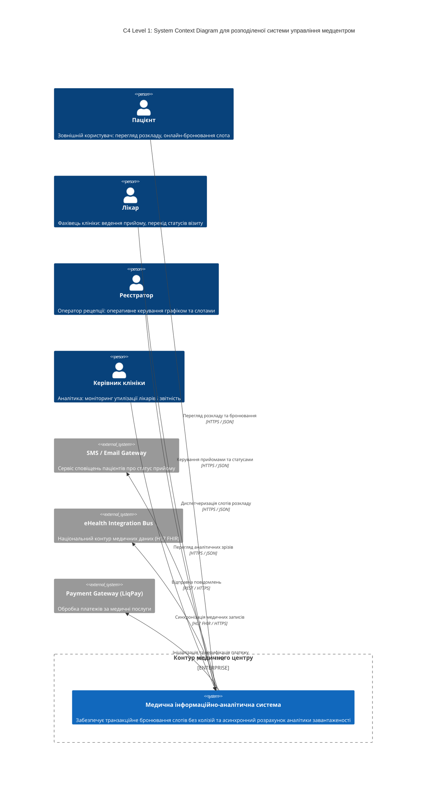
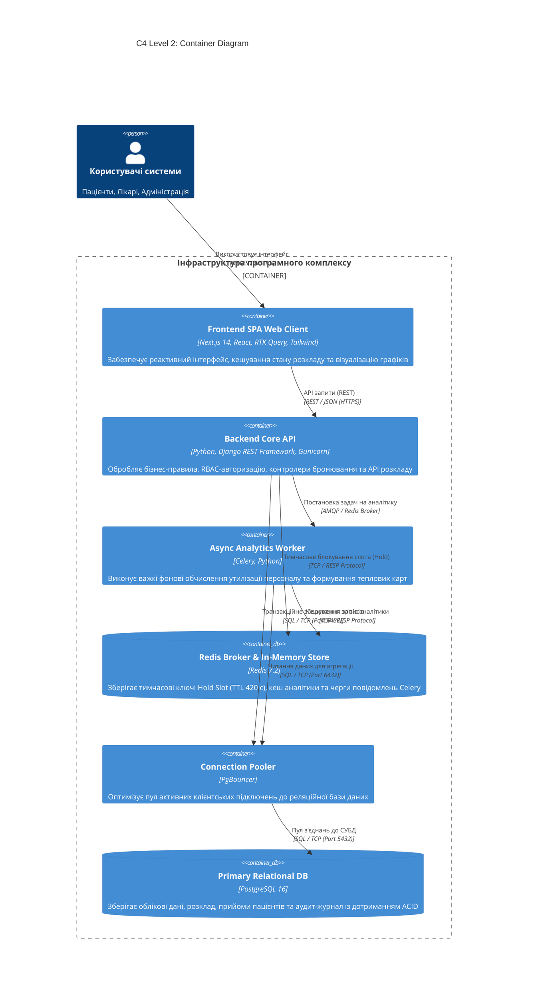
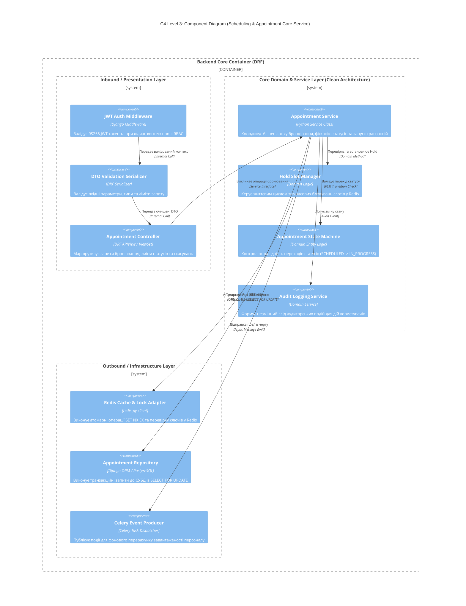
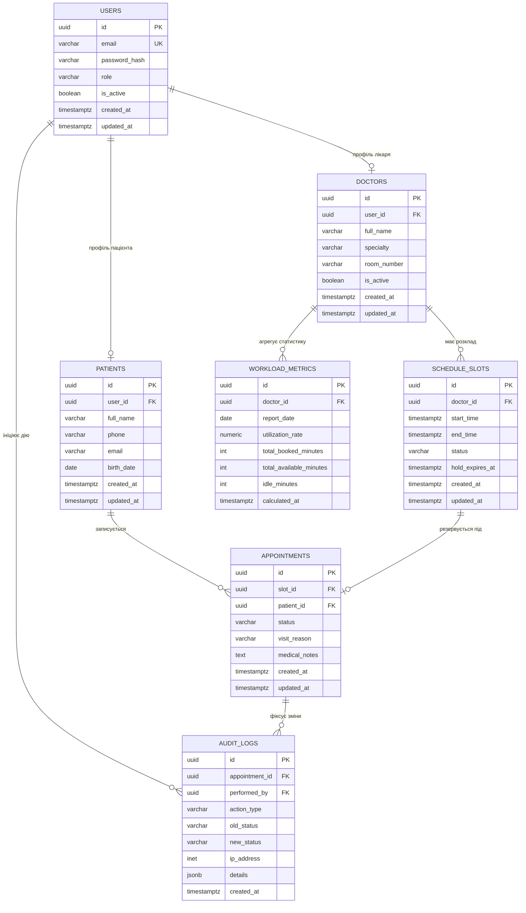
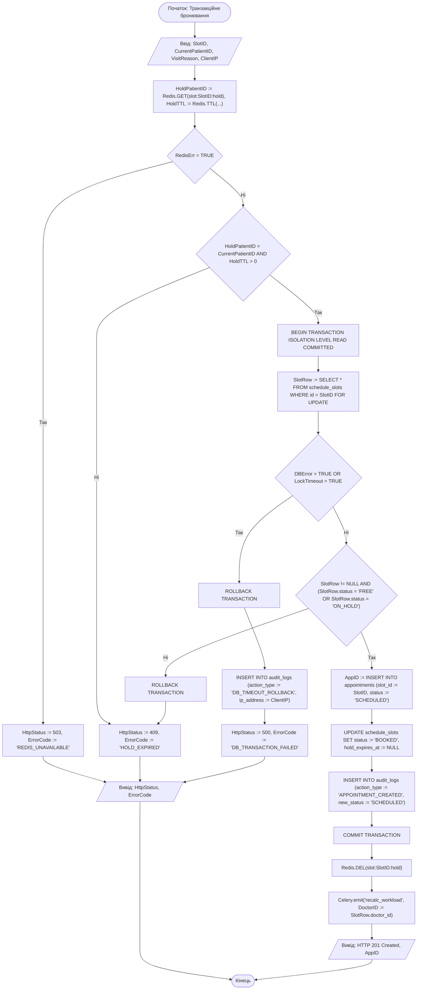

# РОЗДІЛ 2. ПРОЄКТУВАННЯ АРХІТЕКТУРИ СИСТЕМИ

Архітектуру, моделі даних, міжсервісні контракти та алгоритми критичних вузлів інформаційно-аналітичної системи **MedCenter** спроєктовано за методологією **Docs-as-Code** із наскрізним трасуванням до специфікації вимог [`srs.md`](./srs.md) та журналу рішень [`adr/`](./adr/).

## 2.1. Контекстне та контейнерне моделювання системи (C4 Model: Levels 1–2)

### 2.1.1. C4 Рівень 1: Діаграма системного контексту (System Context Diagram)

Діаграма відображає межі медичної інформаційної системи, ролі користувачів та зовнішні інтеграційні шлюзи.

**Текстовий опис та трасування Context рівня:**

* Система підтримує 4 типи акторів, взаємодіючи через протокол `HTTPS / JSON` із застосуванням JWT-авторизації згідно з [SRS-FUN-01](./srs.md#2-functional-requirements-функціональні-вимоги).
* Зовнішня інтеграція із шлюзами сповіщень реалізує вимогу асинхронного сповіщення [SRS-FUN-08](./srs.md#2-functional-requirements-функціональні-вимоги).

---

### 2.1.2. C4 Рівень 2: Контейнерна діаграма (Container Diagram)

Діаграма демонструє фізичний поділ системи на окремо розгорнуті виконувані модулі, сервіси, бази даних та брокери відповідно до технологічного стеку.

**Текстовий опис та трасування зв'язків контейнерів:**

* Контейнер **Frontend SPA** реалізує клієнтське кешування за допомогою RTK Query згідно з [SRS-FUN-07](./srs.md#2-functional-requirements-функціональні-вимоги).
* Контейнер **Redis Broker & Store** реалізує патерн Hold Slot згідно з архітектурним рішенням [ADR-001](./adr/0001-choice-of-technology.md) та вимогою [SRS-FUN-02](./srs.md#2-functional-requirements-функціональні-вимоги).
* Контейнер **Backend Core API** забезпечує транзакційну фіксацію бронювання у **PostgreSQL** із песимістичним блокуванням за вимогою [SRS-FUN-04](./srs.md#2-functional-requirements-функціональні-вимоги).
* Воркери **Celery** здійснюють асинхронний розрахунок аналітики згідно з [SRS-FUN-06](./srs.md#2-functional-requirements-функціональні-вимоги) без деградації Latency основного API ([SRS-NFR-PERF-03](./srs.md#3-non-functional-requirements-нефункціональні-вимоги)).

---

## 2.2. Компонентне моделювання критичного сервісу (C4 Model: Component)

Для деталізації обрано найвідповідальніший сервіс бекенду — **Scheduling & Appointment Service** (сервіс диспетчеризації розкладу та бронювання). Діаграма відображає дотримання принципів Clean Architecture (розділення Inbound, Core та Outbound шарів).

**Текстовий опис та трасування компонентного рівня:**

* **Inbound Layer:** Контролює безпеку запитів за допомогою `JWT Auth Middleware` ([SRS-NFR-SEC-01](./srs.md#3-non-functional-requirements-нефункціональні-вимоги)) та перевіряє цілісність даних через `DTO Validation Serializer`.
* **Core Layer:** Ізолює чисту бізнес-логіку. `Hold Slot Manager` взаємодіє з Redis відповідно до [ADR-001](./adr/0001-choice-of-technology.md), а `Appointment State Machine` забезпечує виконання вимоги [SRS-FUN-05](./srs.md#2-functional-requirements-функціональні-вимоги).
* **Outbound Layer:** `Appointment Repository` реалізує патерн Repository та унеможливлює прямий доступ контролерів до бази даних в обхід бізнес-правил.

---

## 2.3. Документування архітектурних рішень (Architecture Decision Records)

| Індекс | Прийняте рішення | Статус | Трасування |
| :--- | :--- | :--- | :--- |
| [ADR-001](./adr/0001-choice-of-technology.md) | Гібридне блокування конкурентного доступу: Redis Soft Lock (TTL = 420 с) + PostgreSQL `SELECT FOR UPDATE` | Approved | [SRS-FUN-02](./srs.md#2-functional-requirements-функціональні-вимоги), [SRS-FUN-04](./srs.md#2-functional-requirements-функціональні-вимоги) |

---

## 2.4. Проєктування та документування моделей даних (ERD)

Шар збереження даних спроєктовано за принципом **Data-as-Code** для реляційної СУБД **PostgreSQL 16** у Третій нормальній формі (**3NF**) із використанням індустріальної нотації Crow's Foot. За результатами аудиту бази даних було виділено таблицю автентифікації `USERS`, вилучено транзитивну залежність `doctor_id` із таблиці `APPOINTMENTS` (проєкція виконується через `slot_id -> SCHEDULE_SLOTS.doctor_id`), замінено неточний тип `float` на `numeric(5,4)` та додано поле `ip_address` (`inet`) у `AUDIT_LOGS`.

### Специфікація таблиць та полів бази даних (PostgreSQL 16)

#### Таблиця `USERS` (Облікові записи та RBAC)

| Поле | Тип даних | Обмеження | Опис |
| :--- | :--- | :--- | :--- |
| `id` | `UUID` | `PK, DEFAULT gen_random_uuid()` | Унікальний ідентифікатор користувача |
| `email` | `VARCHAR(255)` | `NOT NULL, UNIQUE` | Корпоративна або персональна адреса для входу |
| `password_hash` | `VARCHAR(255)` | `NOT NULL` | Криптографічний хеш пароля (`Argon2id`) |
| `role` | `VARCHAR(20)` | `NOT NULL, CHECK IN ('Patient','Doctor','Registrar','ClinicManager')` | Роль суб'єкта в моделі контролю доступу RBAC |
| `is_active` | `BOOLEAN` | `NOT NULL, DEFAULT TRUE` | Ознака активності облікового запису (Soft Deactivation) |
| `created_at` | `TIMESTAMPTZ` | `NOT NULL, DEFAULT NOW()` | Час створення запису в UTC |
| `updated_at` | `TIMESTAMPTZ` | `NOT NULL, DEFAULT NOW()` | Час останнього оновлення запису |

#### Таблиця `DOCTORS` (Профілі спеціалістів)

| Поле | Тип даних | Обмеження | Опис |
| :--- | :--- | :--- | :--- |
| `id` | `UUID` | `PK, DEFAULT gen_random_uuid()` | Унікальний ідентифікатор лікаря |
| `user_id` | `UUID` | `FK -> USERS(id) ON DELETE RESTRICT, UNIQUE, NOT NULL` | Зв'язок 1:1 із обліковим записом |
| `full_name` | `VARCHAR(150)` | `NOT NULL` | Прізвище, ім'я та по батькові спеціаліста |
| `specialty` | `VARCHAR(100)` | `NOT NULL` | Медична спеціалізація |
| `room_number` | `VARCHAR(20)` | `NOT NULL` | Закріплений кабінет медичного центру |
| `is_active` | `BOOLEAN` | `NOT NULL, DEFAULT TRUE` | Статус доступності спеціаліста у розкладі |
| `created_at` | `TIMESTAMPTZ` | `NOT NULL, DEFAULT NOW()` | Час створення профілю |
| `updated_at` | `TIMESTAMPTZ` | `NOT NULL, DEFAULT NOW()` | Час оновлення профілю |

#### Таблиця `PATIENTS` (Профілі пацієнтів)

| Поле | Тип даних | Обмеження | Опис |
| :--- | :--- | :--- | :--- |
| `id` | `UUID` | `PK, DEFAULT gen_random_uuid()` | Унікальний ідентифікатор пацієнта |
| `user_id` | `UUID` | `FK -> USERS(id) ON DELETE SET NULL, UNIQUE` | Опційний зв'язок з акаунтом онлайн-кабінету |
| `full_name` | `VARCHAR(150)` | `NOT NULL` | ПІБ пацієнта |
| `phone` | `VARCHAR(20)` | `NOT NULL` | Контактний телефон у форматі E.164 |
| `email` | `VARCHAR(255)` | `NULL` | Контактна адреса електронної пошти |
| `birth_date` | `DATE` | `NOT NULL, CHECK (birth_date <= CURRENT_DATE)` | Дата народження пацієнта |
| `created_at` | `TIMESTAMPTZ` | `NOT NULL, DEFAULT NOW()` | Час реєстрації картки пацієнта |
| `updated_at` | `TIMESTAMPTZ` | `NOT NULL, DEFAULT NOW()` | Час останньої зміни профілю |

#### Таблиця `SCHEDULE_SLOTS` (Тайм-слоти розкладу)

| Поле | Тип даних | Обмеження | Опис |
| :--- | :--- | :--- | :--- |
| `id` | `UUID` | `PK, DEFAULT gen_random_uuid()` | Унікальний ідентифікатор слота |
| `doctor_id` | `UUID` | `FK -> DOCTORS(id) ON DELETE CASCADE, NOT NULL` | Ідентифікатор спеціаліста |
| `start_time` | `TIMESTAMPTZ` | `NOT NULL` | Час початку прийому |
| `end_time` | `TIMESTAMPTZ` | `NOT NULL, CHECK (end_time > start_time)` | Час завершення прийому |
| `status` | `VARCHAR(20)` | `NOT NULL, CHECK IN ('FREE','ON_HOLD','BOOKED','CANCELLED')` | Поточний операційний статус слота |
| `hold_expires_at` | `TIMESTAMPTZ` | `NULL` | Час закінчення TTL Soft Lock (синхронізовано з Redis) |
| `created_at` | `TIMESTAMPTZ` | `NOT NULL, DEFAULT NOW()` | Час генерації слота |
| `updated_at` | `TIMESTAMPTZ` | `NOT NULL, DEFAULT NOW()` | Час останньої зміни статусу слота |

#### Таблиця `APPOINTMENTS` (Заброньовані візити)

| Поле | Тип даних | Обмеження | Опис |
| :--- | :--- | :--- | :--- |
| `id` | `UUID` | `PK, DEFAULT gen_random_uuid()` | Унікальний ідентифікатор прийому |
| `slot_id` | `UUID` | `FK -> SCHEDULE_SLOTS(id) ON DELETE RESTRICT, UNIQUE, NOT NULL` | Апаратна гарантія 1:1 захисту від Double-Booking |
| `patient_id` | `UUID` | `FK -> PATIENTS(id) ON DELETE RESTRICT, NOT NULL` | Ідентифікатор пацієнта |
| `status` | `VARCHAR(20)` | `NOT NULL, CHECK IN ('SCHEDULED','IN_PROGRESS','COMPLETED','CANCELLED')` | Стан життєвого циклу візиту (FSM) |
| `visit_reason` | `VARCHAR(500)` | `NOT NULL` | Причина звернення пацієнта |
| `medical_notes` | `TEXT` | `NULL` | Клінічні нотатки лікаря (зашифровано AES-256) |
| `created_at` | `TIMESTAMPTZ` | `NOT NULL, DEFAULT NOW()` | Час фіксації транзакції бронювання |
| `updated_at` | `TIMESTAMPTZ` | `NOT NULL, DEFAULT NOW()` | Час останнього переходу FSM |

#### Таблиця `AUDIT_LOGS` (Журнал безпекового аудиту, Append-Only)

| Поле | Тип даних | Обмеження | Опис |
| :--- | :--- | :--- | :--- |
| `id` | `UUID` | `PK, DEFAULT gen_random_uuid()` | Ідентифікатор запису аудиту |
| `appointment_id` | `UUID` | `FK -> APPOINTMENTS(id) ON DELETE RESTRICT, NULL` | Посилання на змінений прийом (якщо застосовно) |
| `performed_by` | `UUID` | `FK -> USERS(id) ON DELETE RESTRICT, NOT NULL` | Суб'єкт, що ініціював операцію |
| `action_type` | `VARCHAR(50)` | `NOT NULL` | Код події (`APPOINTMENT_CREATED`, `STATUS_CHANGED`, `DB_TIMEOUT_ROLLBACK`) |
| `old_status` | `VARCHAR(20)` | `NULL` | Попередній статус сутності |
| `new_status` | `VARCHAR(20)` | `NULL` | Новий статус сутності |
| `ip_address` | `INET` | `NOT NULL` | Мережева IP-адреса клієнта |
| `details` | `JSONB` | `NULL` | Додатковий контекст діагностики або помилки |
| `created_at` | `TIMESTAMPTZ` | `NOT NULL, DEFAULT NOW()` | Незмінна часова мітка події |

#### Таблиця `WORKLOAD_METRICS` (Агрегована аналітика завантаженості)

| Поле | Тип даних | Обмеження | Опис |
| :--- | :--- | :--- | :--- |
| `id` | `UUID` | `PK, DEFAULT gen_random_uuid()` | Ідентифікатор аналітичного зрізу |
| `doctor_id` | `UUID` | `FK -> DOCTORS(id) ON DELETE CASCADE, NOT NULL` | Ідентифікатор спеціаліста |
| `report_date` | `DATE` | `NOT NULL` | Дата, за якою виконано агрегацію |
| `utilization_rate` | `NUMERIC(5,4)` | `NOT NULL, CHECK (utilization_rate >= 0 AND utilization_rate <= 1)` | Частка завантаженості робочого часу `[0.0000..1.0000]` |
| `total_booked_minutes` | `INTEGER` | `NOT NULL, CHECK (total_booked_minutes >= 0)` | Сумарна тривалість зайнятих слотів у хвилинах |
| `total_available_minutes` | `INTEGER` | `NOT NULL, CHECK (total_available_minutes >= 0)` | Загальний фонд робочих хвилин зміни |
| `idle_minutes` | `INTEGER` | `NOT NULL, CHECK (idle_minutes >= 0)` | Сумарний час простою спеціаліста у хвилинах |
| `calculated_at` | `TIMESTAMPTZ` | `NOT NULL, DEFAULT NOW()` | Час завершення розрахунку воркером Celery |

### План індексування та оптимізації швидкодії (PostgreSQL 16)

* **Складений B-Tree індекс `idx_slots_doctor_range`:** на поля `(doctor_id, start_time, status)` у `SCHEDULE_SLOTS` — забезпечує фільтрацію розкладу зі складністю $O(\log N)$ і виконання вимоги [SRS-NFR-PERF-01](./srs.md#3-non-functional-requirements-нефункціональні-вимоги) (Latency p95 <= 120 мс при 300 RPS).
* **Унікальний індекс `idx_appointments_slot_unique`:** на колонку `(slot_id)` у `APPOINTMENTS` — гарантує апаратну заборону дублювання бронювання на рівні СУБД.
* **Складений унікальний індекс `idx_workload_doctor_date`:** на `(doctor_id, report_date)` у `WORKLOAD_METRICS` — прискорює операції `UPSERT` при фоновому перерахунку Celery та аналітичні вибірки.
* **GIN-індекс `idx_audit_logs_details_gin` та `idx_appointments_notes_gin`:** для швидкого пошуку по структурованому `JSONB`-полю `AUDIT_LOGS.details` та клінічних примітках `APPOINTMENTS.medical_notes`.

---

## 2.5. Специфікація міжсервісних контрактів (API Contracts)

Взаємодія між контейнерами **Frontend SPA Web Client (Next.js 14 / RTK Query)** та **Backend Core API (Django REST Framework)** спроєктована за індустріальним підходом **API-First Design**. Повна машиночитана специфікація у форматі **OpenAPI 3.0.3 (YAML)** зафіксована у файлі [`openapi.yaml`](./api/openapi.yaml).

**Ключові бізнес-інтерфейси контракту:**

1. `POST /api/v1/auth/token` — автентифікація за `Argon2id` та видача пари JWT (`RS256`, Access 15 хв + Refresh у `httpOnly` cookie).
2. `GET /api/v1/schedule/slots` — пагінована вибірка розкладу (`page`, `limit <= 100`) із фільтрацією за лікарем і діапазоном дат.
3. `POST /api/v1/schedule/slots/{id}/hold` — атомарне резервування слота (Soft Lock) у Redis на `TTL = 420` секунд відповідно до [ADR-001](./adr/0001-choice-of-technology.md).
4. `POST /api/v1/appointments` — транзакційне підтвердження запису (Hard Lock) у PostgreSQL із рівнем ізоляції `READ COMMITTED` та `SELECT ... FOR UPDATE`.
5. `PATCH /api/v1/appointments/{id}/status` — переведення статусу візиту за FSM (`SCHEDULED -> IN_PROGRESS -> COMPLETED / CANCELLED`) з фіксацією в `AUDIT_LOGS` та тригером Celery.
6. `GET /api/v1/analytics/workload` — пагінована видача попередньо агрегованої утилізації робочого часу з кешу Redis або `WORKLOAD_METRICS`.

Усі захищені маршрути вимагають схему безпеки `BearerAuth` (`JWT RS256`) та декларують стандартизовану модель помилок `ErrorResponse` для кодів `400`, `401`, `403`, `404`, `409`, `429`, `500`, `503`.

---

## 2.6. Моделювання логіки критичних вузлів (Алгоритми та блок-схеми)

Логіку критичних вузлів формалізовано відповідно до суворих вимог академічного нормоконтролю ЧНУ (ДСТУ): використано виключно оператор присвоювання `:=`, оператор порівняння `=` у ромбах розгалужень, булеві зв'язки `AND`, `OR`, `NOT` великими літерами та індекси масивів `Slots[i]`.

### Алгоритм 1. Атомарне резервування часового слота (Soft Lock у Redis)

**Покроковий формальний опис:**

1. Ввід вхідних параметрів: `SlotID`, `PatientID`, `TTL := 420`.
2. Перевірка валідності параметрів: якщо `SlotID = NULL OR PatientID = NULL`, встановити `HttpStatus := 400`, вивести помилку та завершити алгоритм.
3. Виконання атомарної команди `SET slot:SlotID:hold PatientID NX EX TTL` у Redis з фіксацією статусу з'єднання `RedisErr`.
4. Якщо `RedisErr = TRUE OR Timeout = TRUE`, встановити `HttpStatus := 503` (захист від зависання клієнта при падінні Redis) і завершити.
5. Якщо `LockResult = "OK"`, зафіксувати `SlotStatus := 'ON_HOLD'`, `ExpiresAt := NOW() + TTL`, вивести `HttpStatus := 200` з таймером `420` с; інакше зафіксувати `HttpStatus := 409` (`CONFLICT_SLOT_HELD`).

### Алгоритм 2. Транзакційне бронювання прийому з песимістичним блокуванням (Hard Lock у PostgreSQL)

**Покроковий формальний опис:**

1. Ввід вхідних параметрів: `SlotID`, `CurrentPatientID`, `VisitReason`, `ClientIP`.
2. Перевірка заповненості причини візиту та зчитування власника Soft Lock у Redis: `HoldPatientID := Redis.GET(...)`, `HoldTTL := Redis.TTL(...)`.
3. Якщо `RedisErr = TRUE` — повернути `503`. Якщо `NOT (HoldPatientID = CurrentPatientID AND HoldTTL > 0)` — повернути `409` (`HOLD_EXPIRED_OR_FOREIGN`).
4. Відкриття транзакції `READ COMMITTED`, блокування рядка: `SlotRow := SELECT * FROM schedule_slots WHERE id = SlotID FOR UPDATE`.
5. Якщо `DBError = TRUE OR LockTimeout = TRUE`, виконати `ROLLBACK`, записати подію `DB_TIMEOUT_ROLLBACK` у `AUDIT_LOGS` та вивести `HTTP 500`.
6. Якщо `SlotRow = NULL OR NOT (SlotRow.status = 'FREE' OR SlotRow.status = 'ON_HOLD')`, виконати `ROLLBACK` та вивести `HTTP 409`.
7. Створити запис в `APPOINTMENTS` (`Status := 'SCHEDULED'`), оновити `SCHEDULE_SLOTS.status := 'BOOKED'`, зафіксувати `AUDIT_LOGS`, виконати `COMMIT`.
8. Видалити тимчасовий ключ `Redis.DEL(slot:SlotID:hold)`, поставити фонову задачу `Celery.emit('recalc_workload', SlotRow.doctor_id)` та вивести `HTTP 201`.

### Алгоритм 3. Асинхронний розрахунок коефіцієнта завантаженості лікаря (Celery Task)

**Покроковий формальний опис:**

1. Ініціалізація параметрів фонової задачі: `DoctorID`, `TargetDate`, `MaxRetries := 3`, `RetryCount := 0`.
2. Вибірка масиву слотів спеціаліста за дату: `Slots := SELECT * FROM schedule_slots WHERE doctor_id = DoctorID AND DATE(start_time) = TargetDate`.
3. Ініціалізація акумуляторів: `TotalMinutes := 0`, `BookedMinutes := 0`, `i := 0`, `N := LENGTH(Slots)`.
4. Цикл `i < N`: обчислення тривалості `Duration := (Slots[i].end_time - Slots[i].start_time) / 60`. Якщо `NOT (Slots[i].status = 'CANCELLED')`, додати до `TotalMinutes := TotalMinutes + Duration`. Якщо `Slots[i].status = 'BOOKED' AND Duration > 0`, додати до `BookedMinutes := BookedMinutes + Duration`. Ітератор `i := i + 1`.
5. Захист від ділення на нуль: якщо `N = 0 OR TotalMinutes = 0`, встановити `UtilizationRate := 0.0000`, `IdleMinutes := 0`; інакше `UtilizationRate := ROUND(BookedMinutes / TotalMinutes, 4)`, `IdleMinutes := TotalMinutes - BookedMinutes`.
6. Збереження `WORKLOAD_METRICS` (UPSERT) у PostgreSQL. При `DBError = TRUE AND RetryCount < MaxRetries` виконати повторну постановку з експоненційною затримкою `Backoff := 2^RetryCount * 5` с.
7. Оновлення кешу в Redis `SET cache:workload:DoctorID:TargetDate UtilizationRate EX 1800` та завершення задачі.

---

## 2.7. Інтеграційний аудит та верифікація цілісності доменів (Production Readiness Report)

Проведено наскрізний аудит узгодженості схеми БД (`2.4`), контракту OpenAPI 3.0.3 (`2.5`) та алгоритмів критичних вузлів (`2.6`).

### 1. Звірка типів даних та сигнатур (API-to-Database Verification)

| Сутність / Атрибут | Схема БД (PostgreSQL 16) | Контракт OpenAPI 3.0.3 | Статус узгодження |
| :--- | :--- | :--- | :--- |
| Ідентифікатори (`id`, `doctor_id`, `slot_id`, `patient_id`) | `UUID` (`PK` / `FK`) | `type: string, format: uuid` | Синхронізовано |
| Часові мітки (`start_time`, `end_time`, `hold_expires_at`, `created_at`, `updated_at`) | `TIMESTAMPTZ` (UTC) | `type: string, format: date-time` (ISO-8601) | Синхронізовано |
| Дати (`birth_date`, `report_date`, `start_date`, `end_date`) | `DATE` | `type: string, format: date` | Синхронізовано |
| Статуси слота (`SCHEDULE_SLOTS.status`) | `VARCHAR(20)` + `CHECK` | `SlotStatus` `enum: [FREE, ON_HOLD, BOOKED, CANCELLED]` | Синхронізовано |
| Статуси прийому (`APPOINTMENTS.status`) | `VARCHAR(20)` + `CHECK` | `AppointmentStatus` `enum: [SCHEDULED, IN_PROGRESS, COMPLETED, CANCELLED]` | Синхронізовано |
| Коефіцієнт завантаженості (`utilization_rate`) | `NUMERIC(5,4)` (`0..1`) | `type: number, format: double, minimum: 0.0, maximum: 1.0` | Синхронізовано |
| Аудит IP (`AUDIT_LOGS.ip_address`) | `INET` (`NOT NULL`) | Заповнюється на рівні сервісу з `X-Forwarded-For` / `REMOTE_ADDR` | Синхронізовано |
| Проєкція `Appointment.doctor_id` | Відсутня в `APPOINTMENTS` (3NF) | Повертається в DTO `Appointment` через `JOIN SCHEDULE_SLOTS` | Синхронізовано |

### 2. Звірка логіки алгоритмів, API та БД (Logic-to-API/Data Verification)

* Усі змінні алгоритмів 1–3 (`SlotID`, `PatientID`, `TTL = 420`, `VisitReason`, `ClientIP`, `DoctorID`, `TargetDate`, `UtilizationRate`, `BookedMinutes`, `TotalMinutes`, `IdleMinutes`) мають пряме відображення у полях БД та схемах OpenAPI.
* Час утримання слота `TTL = 420` секунд (7 хвилин) уніфіковано між [SRS-FUN-02](./srs.md#2-functional-requirements-функціональні-вимоги), [ADR-001](./adr/0001-choice-of-technology.md), [`openapi.yaml`](./api/openapi.yaml) та Алгоритмами 1–2.
* Спискові методи `GET /schedule/slots` та `GET /analytics/workload` оснащено параметрами пагінації `page` та `limit` (`max 100`), що відповідає мережевим інваріантам проєкту.

### 3. Підсумковий висновок (Production Readiness)

Наскрізних конфліктів інтеграції (`API-to-Database` та `Logic-to-API/Data`) не виявлено. Специфікації шару даних, міжсервісних контрактів та алгоритмів визнано повністю узгодженими та готовими до етапу консолідації та реалізації.

---

## AI Insights (AI Disclosure ЛР№5–№6)

* **Лог №1 (C4 Model, ЛР№5):** За зауваженням ШІ-рев'юєра додано пул з'єднань `PgBouncer` на C4 Container та компоненти `DTO Validation Serializer` і `Audit Logging Service` на C4 Component.
* **Лог №2 (ERD, ЛР№6 Завд.1):** Data Layer Auditor виявив відсутність таблиці `USERS` для JWT/RBAC, транзитивну залежність `APPOINTMENTS.doctor_id` (порушення 3NF), тип `float` замість `NUMERIC(5,4)` для точності метрик та відсутність `ip_address` у `AUDIT_LOGS`. Усі зауваження усунуто, додано таблиці специфікацій полів та індекси `idx_slots_doctor_range`, `idx_appointments_slot_unique`.
* **Лог №3 (OpenAPI, ЛР№6 Завд.2):** API Reviewer підсвітив відсутність пагінації `page`/`limit`, відсутність ендпоінтів `/auth/token`, `/appointments/{id}/status`, `/analytics/workload` та неповний перелік негативних відповідей `403/429/503`. Контракт розширено до 6 ендпоінтів зі схемою `BearerAuth` та суворими обмеженнями DTO.
* **Лог №4 (Алгоритми, ЛР№6 Завд.3):** Нормоконтролер ДСТУ вказав на ризик ділення на нуль у Celery-задачі при `TotalMinutes = 0`, відсутність перевірки `RedisErr`/`DBError` та недостатню деталізацію операторів `:=`, `AND`/`OR`/`NOT`, блоків вводу/виводу `[/.../]`. Логіку перебудовано з додаванням гілок `ROLLBACK`, `Retry` та перевірки порожнього масиву.
* **Лог №5 (Інтеграційний аудит, ЛР№6 Завд.4):** Integration Gatekeeper виявив початковий розсинхрон `TTL` (`600` с у чернетках vs `420` с у `SRS`/`ADR-001`), відсутність `ip_address` в ERD та невідповідність між переліком ендпоінтів і `openapi.yaml`; виконано повну синхронізацію артефактів (детальні протоколи сесій та початкові чернетки зафіксовано в Notion PKM).
