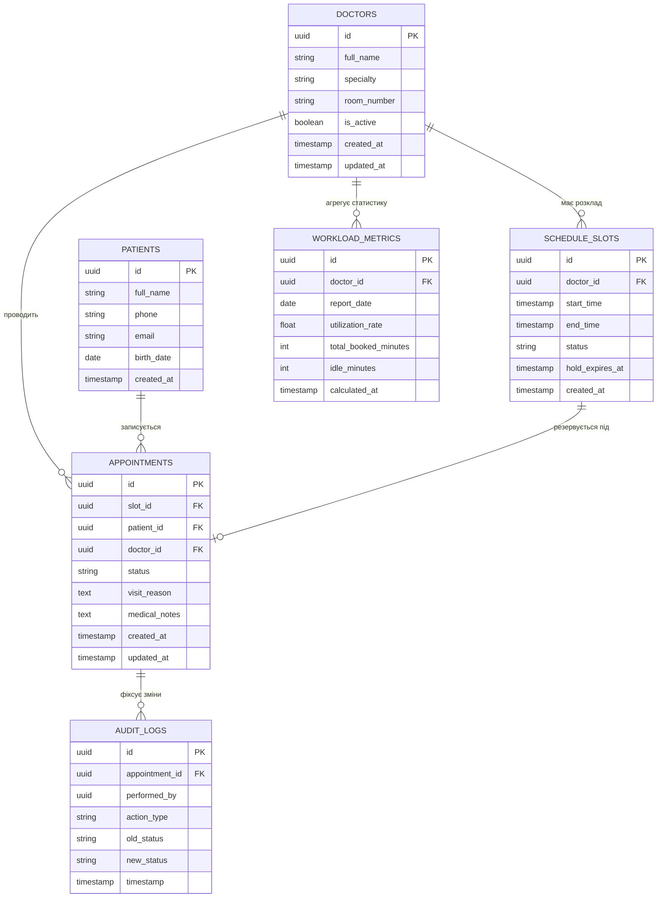
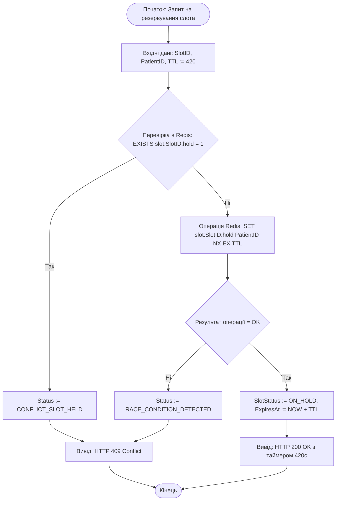
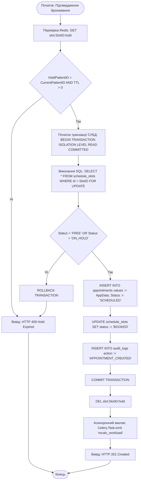

# Інженерна документація кваліфікаційного проєкту (F2-diploma-project)

## Тема проєкту
* **Українською:** Розробка розподіленої інформаційно-аналітичної системи управління медичним центром із модулем оптимізації та аналізу завантаженості спеціалістів
* **English:** Engineering of a Distributed Healthcare Management System with Specialist Workload Optimization and Analytics
* **Спеціальність:** 121 «Інженерія програмного забезпечення» (освітня програма F2)
* **Технологічний стек:** Next.js (App Router), TypeScript, React, RTK Query, Python / Django REST Framework, Celery, Redis, PostgreSQL, Docker, GitHub Actions

---

## Навігаційний дашборд документації

| Розділ / Артефакт | Опис | Посилання | Статус |
| :--- | :--- | :--- | :--- |
| **Thesis Proposal** | Концепція проєкту, стек, актуальність та аналоги | [`proposal.md`](./proposal.md) | `Done` |
| **Розділ 1 (Аналітика)** | Аналіз предметної області (As-Is), To-Be модель, Core Features | [`1_analysis.md`](./1_analysis.md) | `Done` |
| **Розділ 1 (Моноліт .docx)** | Повний зведений академічний документ першого розділу (8 сторінок) | [`F2_Diploma_Chapter1.docx`](./F2_Diploma_Chapter1.docx) / [Notion PKM](https://app.notion.com/p/F2_Diploma_-_-3dedff09ecc68016a39dc7f487367050) | `Done` |
| **Розділ 2 (Проєктування)** | C4 Model, UML Use Case, ERD, OpenAPI, алгоритми | [`2_design.md`](./2_design.md) | `In Progress` |
| **Розділ 3 (Реалізація)** | Архітектура коду, тестування k6, DevSecOps | [`3_implementation.md`](./3_implementation.md) | `Planned` |
| **Висновки** | Загальні результати кваліфікаційної роботи | [`4_conclusions.md`](./4_conclusions.md) | `Planned` |

---

## Зведена матриця нефункціональних вимог (NFRs Matrix)

| Індекс вимоги | Категорія | Технічний показник | Цільове значення (2026) | Метод валідації |
| :--- | :--- | :--- | :--- | :--- |
| **SRS-NFR-PERF-01** | Продуктивність | Latency p95 (читання розкладу) | **<= 120 мс** при 300 RPS | k6 Spike / Load Testing |
| **SRS-NFR-PERF-02** | Продуктивність | Latency p95 (транзакція бронювання) | **<= 250 мс** при 100 RPS | k6 Concurrent Stress Test |
| **SRS-NFR-PERF-03** | Продуктивність | Час розрахунку аналітики (Async) | **<= 3.0 с** (фонова черга Celery) | Prometheus / Celery Flower |
| **SRS-NFR-SCAL-01** | Масштабованість | Архітектура бекенду | **Stateless**, до 10 реплік pods | Docker Compose / Kube HPA |
| **SRS-NFR-SCAL-02** | Масштабованість | Пул підключень до PostgreSQL | **До 1000 клієнтів** (PgBouncer) | PgBouncer pool profiling |
| **SRS-NFR-SEC-01** | Безпека | Автентифікація та авторизація | **OAuth 2.0 / JWT (RS256)** | OWASP ZAP / JWT Inspector |
| **SRS-NFR-SEC-02** | Безпека | Шифрування даних | **TLS 1.3** (трафік), **AES-256** (БД) | Trivy / SonarQube Scanner |
| **SRS-NFR-SEC-03** | Безпека | Мережевий захист та ліміти | **Rate Limiting 100 req/min** | Nginx / Django Ratelimit |
| **SRS-NFR-REL-01** | Надійність | Доступність системи (Uptime SLA) | **SLA >= 99.9%** | Uptime Kuma / Health Check |
| **SRS-NFR-REL-02** | Надійність | Disaster Recovery (PostgreSQL WAL) | **RPO <= 15 хв, RTO <= 60 хв** | pg_dump / WAL backup scripts |

---

## 2.4. Проєктування та документування моделей даних (ERD)

Шар збереження даних спроєктовано за принципом Data-as-Code у вигляді реляційної схеми PostgreSQL 16 у Третій нормальній формі (3NF) із дотриманням нотації Crow's Foot.



**План індексування та оптимізація швидкодії (PostgreSQL 16):**
* **B-Tree індекс `idx_slots_doctor_range`:** за полями `(doctor_id, start_time, status)` — забезпечує пошук доступних слотів розкладу за час $O(\log N)$ з Latency p95 < 20 мс.
* **B-Tree індекс `idx_appointments_slot_unique`:** унікальний індекс на `(slot_id)` для виключення дублювання записів на рівні рушія СУБД.
* **GIN індекс `idx_appointments_notes_gin`:** для повнотекстового пошуку по медичних примітках пацієнта (`medical_notes`).

---

## 2.5. Специфікація міжсервісних контрактів (API Contracts)

Взаємодія між Frontend SPA клієнтом та Backend Core API реалізована за стандартом API-First Design. Повна специфікація ендпоінтів у форматі OpenAPI 3.0 зафіксована у файлі [openapi.yaml](./api/openapi.yaml).

**Ключові ендпоінти взаємодії:**
* `GET /api/v1/schedule/slots` — вибірка доступних слотів із підтримкою кешування та пагінації;
* `POST /api/v1/schedule/slots/{id}/hold` — атомарне встановлення TTL Hold Slot у Redis на 420 секунд згідно з [ADR-001](./adr/0001-choice-of-technology.md);
* `POST /api/v1/appointments` — транзакційне підтвердження бронювання в PostgreSQL із песимістичним блокуванням (`SELECT FOR UPDATE`).

---

## 2.6. Моделювання логіки критичних вузлів (Блок-схеми за нормоконтролем)

Логіка критичних вузлів формалізована у строгому математичному стилі із використанням оператора присвоювання `:=`, булевих операторів `AND`, `OR`, `NOT` та індексів масивів згідно з вимогами нормоконтролю ДСТУ.

### Алгоритм 1. Атомарне резервування часового слота (Hold Slot Pipeline)



### Алгоритм 2. Транзакційне збереження прийому з песимістичним блокуванням



### Алгоритм 3. Асинхронний розрахунок коефіцієнта завантаженості лікаря (Celery Task)

```mermaid
graph TD
    StartWorker([Початок: Celery Task recalc_workload]) --> LoadParams[Вхідні дані: DoctorID, TargetDate]
    LoadParams --> FetchSlots[Вибірка слотів за день: Slots := SELECT * FROM schedule_slots WHERE doctor_id = DoctorID]
    FetchSlots --> InitCounters[TotalMinutes := 0, BookedMinutes := 0, i := 0, N := LENGTH Slots]
    InitCounters --> LoopCond{i < N}
    LoopCond -- Так --> SlotDuration[Duration := Slots[i].end_time - Slots[i].start_time]
    SlotDuration --> AddTotal[TotalMinutes := TotalMinutes + Duration]
    AddTotal --> CheckBooked{Slots[i].status = 'BOOKED'}
    CheckBooked -- Так --> AddBooked[BookedMinutes := BookedMinutes + Duration]
    CheckBooked -- Ні --> NextIter[i := i + 1]
    AddBooked --> NextIter
    NextIter --> LoopCond

    LoopCond -- Ні --> CalcRate[UtilizationRate := ROUND BookedMinutes / TotalMinutes, 4]
    CalcRate --> SaveMetrics[INSERT INTO workload_metrics values := DoctorID, UtilizationRate, TargetDate]
    SaveMetrics --> CacheRedis[SET cache:workload:DoctorID:TargetDate UtilizationRate EX 1800]
    CacheRedis --> EndWorker([Кінець: Task Finished])
```

---

## 2.7. Інтеграційний аудит та верифікація цілісності доменів (Production Readiness Report)

Проведено перехресний інтеграційний аудит між моделлю даних (ERD), API-контрактом (OpenAPI 3.0) та алгоритмами критичних вузлів.

* **Контроль узгодженості типів даних (API-to-Database):**  
  * Поля первинних та зовнішніх ключів `id`, `doctor_id`, `slot_id`, `patient_id` мають уніфікований тип `UUID` як у схемі PostgreSQL, так і у форматі `type: string, format: uuid` у специфікації OpenAPI.
  * Статуси прийомів `[SCHEDULED, IN_PROGRESS, COMPLETED, CANCELLED]` та слотів `[FREE, ON_HOLD, BOOKED, CANCELLED]` повністю синхронізовані між полями переліку `enum` в OpenAPI та значеннями колонок у базі даних.
* **Контроль цілісності логіки та даних (Logic-to-Data):**  
  * Усі змінні, якими оперують алгоритми 1–3 (`SlotID`, `PatientID`, `TTL`, `Duration`, `UtilizationRate`), представлені відповідними атрибутами у таблицях `SCHEDULE_SLOTS`, `APPOINTMENTS` та `WORKLOAD_METRICS`.
* **Висновок аудиту (Production Readiness):**  
  Архітектурні специфікації нижнього рівня є на 100% узгодженими, конфлікти інтеграції відсутні. Специфікації визнано повністю готовими до передачі в програмну реалізацію (Розділ 3).
