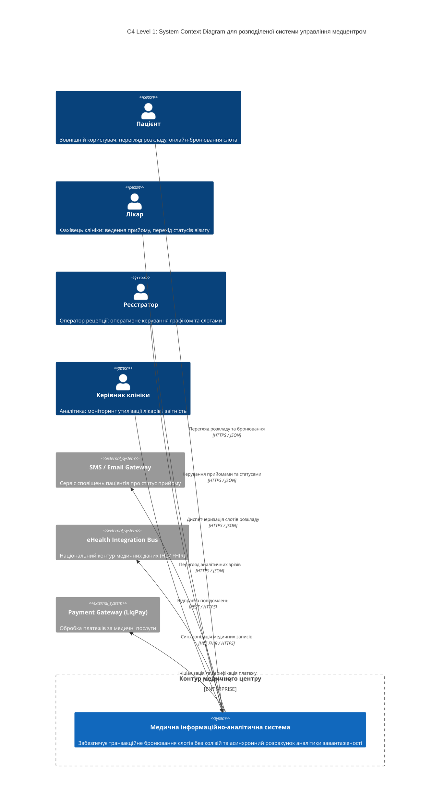
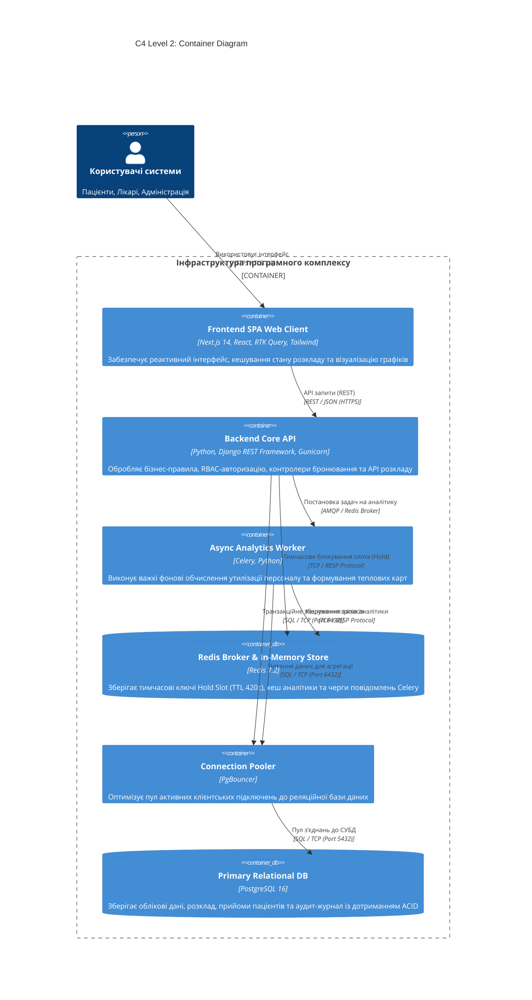
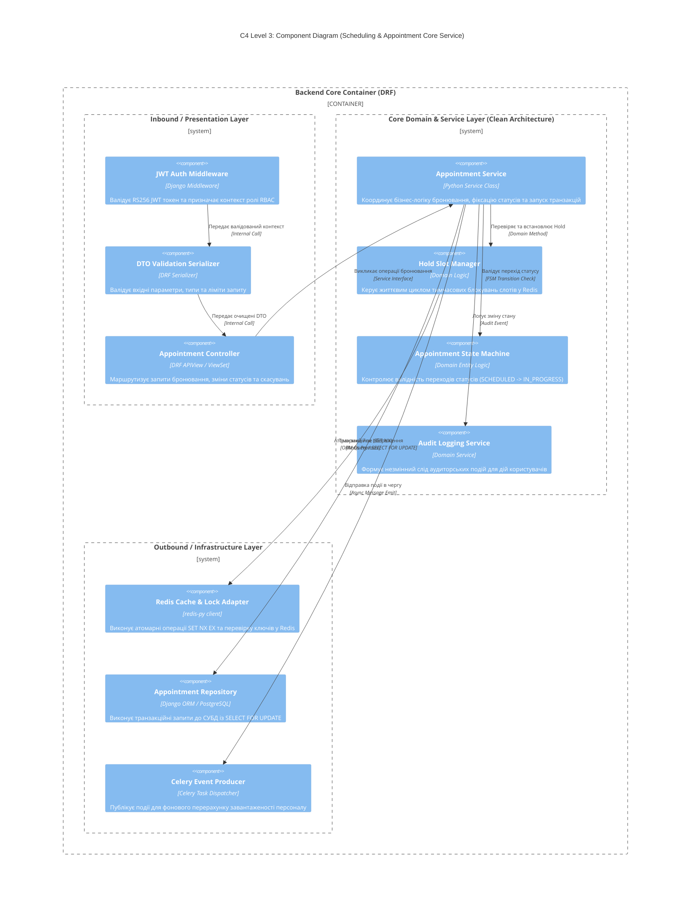

# РОЗДІЛ 2. АРХІТЕКТУРНЕ ТА АЛГОРИТМІЧНЕ ПРОЄКТУВАННЯ СИСТЕМИ

## 2.1. Контекстне та контейнерне моделювання системи (C4 Model: Levels 1–2)

### 2.1.1. C4 Рівень 1: Діаграма системного контексту (System Context Diagram)
Діаграма відображає межі медичної інформаційної системи, ролі користувачів та зовнішні інтеграційні шлюзи.

**Текстовий опис та трасування Context рівня:**
* Система підтримує 4 типи акторів, взаємодіючи через протокол `HTTPS / JSON` із застосуванням JWT-авторизації згідно з [SRS-FUN-01](./srs.md#2-functional-requirements).
* Зовнішня інтеграція із шлюзами сповіщень реалізує вимогу асинхронного сповіщення [SRS-FUN-08](./srs.md#2-functional-requirements).

---

### 2.1.2. C4 Рівень 2: Контейнерна діаграма (Container Diagram)
Діаграма демонструє фізичний поділ системи на окремо розгорнуті виконувані модулі, сервіси, бази даних та брокери відповідно до технологічного стеку.

**Текстовий опис та трасування зв'язків контейнерів:**
* Контейнер **Frontend SPA** реалізує клієнтське кешування за допомогою RTK Query згідно з [SRS-FUN-07](./srs.md#2-functional-requirements).
* Контейнер **Redis Broker & Store** реалізує патерн Hold Slot згідно з архітектурним рішенням [ADR-001](./adr/0001-choice-of-technology.md) та вимогою [SRS-FUN-02](./srs.md#2-functional-requirements).
* Контейнер **Backend Core API** забезпечує транзакційну фіксацію бронювання у **PostgreSQL** із песимістичним блокуванням за вимогою [SRS-FUN-04](./srs.md#2-functional-requirements).
* Воркери **Celery** здійснюють асинхронний розрахунок аналітики згідно з [SRS-FUN-06](./srs.md#2-functional-requirements) без деградації Latency основного API ([SRS-NFR-PERF-03](./srs.md#3-non-functional-requirements)).

---

## 2.2. Компонентне моделювання критичного сервісу (C4 Model: Component)
Для деталізації обрано найвідповідальніший сервіс бекенду — **Scheduling & Appointment Service** (сервіс диспетчеризації розкладу та бронювання). Діаграма відображає дотримання принципів Clean Architecture (розділення Inbound, Core та Outbound шарів).

**Текстовий опис та трасування компонентного рівня:**
* **Inbound Layer:** Контролює безпеку запитів за допомогою `JWT Auth Middleware` ([SRS-NFR-SEC-01](./srs.md#3-non-functional-requirements)) та перевіряє цілісність даних через `DTO Validation Serializer`.
* **Core Layer:** Ізолює чисту бізнес-логіку. `Hold Slot Manager` взаємодіє з Redis відповідно до [ADR-001](./adr/0001-choice-of-technology.md), а `Appointment State Machine` забезпечує виконання вимоги [SRS-FUN-05](./srs.md#2-functional-requirements).
* **Outbound Layer:** `Appointment Repository` реалізує паттерн Repository та унеможливлює прямий доступ контролерів до бази даних в обхід бізнес-правил (відсутність Tight Coupling та Spaghetti Code).

---

## AI Insights (AI Disclosure)
* **Промпт архітектурного рев'ю C4:** Перевірка відповідності діаграм C4 вимогам SRS та відсутність втрачених компонентів.
* **Зауваження ШІ-Рев'юера:** Було підсвічено відсутність пулу з'єднань PgBouncer на C4 Container та брак шару валідації DTO / Middleware на C4 Component.
* **Внесені виправлення:** Додано PgBouncer у схему контейнерів між API та PostgreSQL; на рівні компонентів додано DTO Validation Serializer та явний аудит-сервіс.
